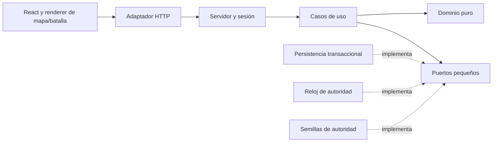

# ARCANA — Fase 2 Arquitectura y dominio

Estado vigente: A48 y [auditoría final](FINAL-ACCEPTANCE-AUDIT.md). Apartados de diseño inicial y bloques anteriores conservan pendientes históricos; no describen capacidades ausentes hoy. Alcance actual en REQUIREMENTS-STATUS.md.

A48: ReplayPassive inmutable amplía proyección cliente, valida activación frente a input inicial/engine v1 y asocia bonos a equipo completo. BattlePanel separa guard de snapshot y playback con hooks; DTO/tx/SQL/eventos de dominio no cambian. Vista formatea tier/valor e identifica posición, sin recalcular reglas.

A47: BattlePanel entrega posiciones DOM medidas mediante ResizeObserver al adaptador Pixi; cero geometría DOM leída por frame. mapLayout acepta spacing visual sin cambiar IDs/adyacencia. Nav reserva altura real; fixture de carga solo pruebas. Núcleo/tx/seed sin cambio, no framework o dependencia nueva.

A46: navigation/operation-error son helpers de presentación puros; useNavigation adapta History/hash a React, sin comandos económicos o router externo. Normalización de fragmento en worker no amplía caché de API.

A45: Worker como adaptador de distribución estática; núcleo y autoridad no dependen de él. Precache exacto generado por build, configuración TS WebWorker separada. Ninguna cola económica offline o nuevo repositorio.

A44: `domain/exploration/encounters` aplica efectos y produce resolución inmutable; snapshot persistido se valida contra PV finales/recompensa con el mismo servicio. `EncounterChoice`/`EncounterNarrative` versionado, seed/índice/resolución en `NodeReceipt`, app coordina selección/transacción. `EncounterOutcome` solo muestra historia/dato guardado, con texto es/en y representación de PV/porcentaje. SQL/HTTP/controller existentes bastan; no motor narrativo, bus o repositorio adicional.

A43: `WizardDefinition.stars?: StarCount` (1|2|3|4|5) conserva compatibilidad con snapshots históricos; validación/snapshot/adquisición y coincidencia copia/receipt incluyen dato. El catálogo público proyecta estrellas explícitas; `StarRating` solo representa símbolos decorativos y mensaje localizado. Sin cálculo rareza→estrellas en React, tabla nueva o migración SQL; versión de catálogo/tabla de ensayo 2. `CromodexEntry` conserva primer descubrimiento y cada copia su valor/versiones.

A42: `domain/economy/commerce` valida recetas/tabla y transforma inventario inmutable; `application/commerce-use-cases` conserva coste/pieza/botín/receipt en una tx. Puerto de tickets solo para canje; replay precede configuración/azar. Snapshots de equipo comparados por proyección canónica, compatibles con JSONB. API/controller reutilizados y `commerceOffers` comparte gates con dominio; `CommercePanel` guarda únicamente selección/cotización. PostgreSQL relacional/receipt JSONB existente basta, verificado sin migración o repositorio adicional. Configuración pública es versión de ensayo, no balance aprobado.

A41: `application/player-status` proyecta y valida DTO temporal; reserva SQL permanece intacta. `domain/combat/synergies` comparte umbrales con engine/preview. Controller refresca sin borrar receipt, descarta otro dueño/revisión anterior y mantiene éxito si falla consulta posterior. `latestNodeReceipt` usa run+última visita, no orden de almacenamiento. `PlayerHud`, `TeamHud`, `NodeResult` separan vista; MapPanel desplaza por identidad/elecciones reales, no identidad de objetos recreados en HTTP.

A40: `presentation/CollectionPanel` separa álbum/inspección/loadout; `BeanAssignments` mantiene únicamente borrador de IDs antes de confirmar. Reutiliza `SetTeam`/`EquipEquipment`/`AdvanceNode`, sin reglas o azar nuevos en vista. Copias muestran snapshots y PV/PM de run activa; operaciones y recuperación siguen en controller/servidor.

A39: `application/client/battle-replay.ts` proyecta campos de eventos inmutables y valida frame final, sin engine/RNG/framework. `presentation/{MapPanel,BattlePanel,CardReveal}` separa vistas/control visual; `scenes/{map-layout,SceneCanvas,pixi-scenes}` separa coordenadas, lifecycle React y adaptador WebGL. Assets/librerías lazy, renderer actualiza data a través de un contrato pequeño `update/destroy`; no bus genérico o motor de animación futuro. Cache de geometría estática y capa dinámica por medición, no por anticipación.

A38 añade `infrastructure/content/trial-configuration`, JSON provisional versionado, gateway HttpOnly de mismo origen y launcher Vite opt-in que conecta servicios locales. `application/client/read-models` contiene CromodexEntry (proyección, sin segunda tx económica), probabilidades y adyacencia; copies guardadas conservan snapshots/versiones. `presentation` consume controller/snapshots, mensajes por claves es/en y parámetros/plurales, sin RNG o engine. UI DOM inicial; renderer/componentes por vista y QA completo siguen pendientes. `LOCAL-TRIAL-CONTRACT.md` distingue configuración técnica de aprobación de producto.

A37 implementa `application/client/{ports,errors,game-controller}` y `infrastructure/client/client-operations` (IndexedDB) junto al adapter HTTP. Frontera de metadata de transporte, sin inventario local autoritativo o dependencia de React. Controller no calcula premios/combate; recibe snapshots confirmados y recupera por key antes de presentar. Contrato/evidencia en `CLIENT-CONTROLLER-CONTRACT.md` y `PHASE-4-STATUS.md`.

Diseño del 11 octubre de 2026, posterior a la auditoría. Actualizado a A32: PostgreSQL/Redis/PixiJS v8/GSAP requeridos; React/Vite + Node/TypeScript/Fastify elegidos entre alternativas explícitas. Balance U25 e identidad/recuperación U26 pendientes. Los nombres de tipos y carpetas son elecciones de ingeniería, no ampliación de producto.

## Dependencias y estructura

```text
src/arcana/
  domain/
    exploration/   route, generate-route, coordinate, run, nodes, encounters
    combat/        engine, record, beans, mana, seed, random, synergies
    collection/    wizards, rarity, team
    economy/       essence, rewards, inventory, commerce
  application/
    game, authority-ports, public-content, player-status, prepare-team
    run/shop/team/commerce contracts y casos de uso
    client/        controller, ports, read-models, battle-replay
  infrastructure/
    random/        seeded-random, crypto-random
    postgres/      schema.sql, game-transactions
    redis/         authority
    http/          api, schemas, composition, client, local-runtime, trial-gateway
    client/        client-operations (solo metadata de transporte)
    content/       trial-configuration
    pwa/           register, service-worker
  content/         trial-v1.json (configuración provisional versionada)
  presentation/   vistas React, traducciones, navigation, operation-error, scenes/PixiJS
 tools/arcana/     launcher local opt-in y builder PWA
 tests/domain/arcana/      dominio/aplicación y helpers puros
 tests/integration/       PostgreSQL/Redis reales
 tests/browser-trial/     UI/recorrido conectado
 tests/browser-arcana/    metadata IndexedDB real
 tests/browser-pwa/       build/worker reales
```

No obligación de crear todos esos archivos si dos responsabilidades pequeñas caben juntas. El directorio `src/arcana` permite desarrollar el nuevo contrato sin alterar las pruebas y datos históricos. La aplicación nueva ya sustituye el entrypoint desde A38; la configuración provisional no equivale a balance aprobado. Assets antiguos deben quedar fuera de `public` para el build nuevo; conservar fuentes históricas fuera de distribución.



El renderer consume eventos/resultados inmutables; Auto/2x/omitir cambia reproducción. React no calcula daño, entrega, validación de nodo, regeneración o precio. No hay un puerto por botón o vista. El contrato de presentación es una proyección tipada del resultado; una interfaz de motor gráfico solo será necesaria si hay dos implementaciones reales.

## Bounded Contexts e invariantes

| Contexto | Aggregate / entidades | Value Objects | Servicios / eventos |
| --- | --- | --- | --- |
| Exploration | RouteRun; RouteNode por ID, aristas de NodeGraph | NodeId, RouteVersion, Path, NodeKind | validación DAG/avance; NodeResolved, RouteCompleted |
| CombatEngine | Battle (snapshot de combatientes y resultado); Combatant con ID estable y estado de efectos | CombatSeed, Stats, Affinity, Initiative, Health, EngineVersion | resolveBattle, initiativeOrder, beanEffect, synergy; SpellCast, BeanActivated, CombatFinished |
| Collection | WizardCollection; WizardDefinition y OwnedWizard por instancia/copia | WizardId, Rarity, CatalogVersion, Discovery | acquireCopy, prepareTeam; WizardDiscovered, CopyAcquired, TeamPrepared |
| InventoryEconomy | PlayerInventory; ProductUnit y EquipmentInstance | Crowns, Essence, RegenerationCursor, ProductId, UnitId, OperationKey | regenerateEssence, consumeEssence, victoryReward, purchase; EssenceSpent, PurchaseCommitted, ToadOpened |

Los VO validan invariantes reales: PV entre 0 y máximo; Coronas entero no negativo/seguro; Esencia 0..50; seed representable; IDs no vacíos; pesos positivos/referencias existentes. Tipos readonly + funciones puras de transición; no clase por cada escalar. IDs/versiones compartidos entre idiomas. Datos externos se validan antes de convertir a tipos; `readonly` no reemplaza validación runtime.

`RouteRun` acepta solo nodo raíz permitido al comenzar y después una arista saliente del actual, sin retroceso, salto, nodo ya resuelto o más de una elección en la misma fila. Un grafo de contenido tiene IDs únicos, referencias existentes, sin ciclos y jefe alcanzable. La topología exacta y definición de repetición se fijan en configuración de producto, no en componentes.

`Battle` es autocontenido: combatientes, vida residual, stats/equipo/consumibles resueltos, seed, motor/config versionados. El motor nunca lee catálogo actual ni reloj global durante simulación. Desempates/límite/daño/PM siguen U25; una decisión de motor deberá quedar explícita y comprobable. Semilla idéntica + entrada idéntica + versión idéntica produce todos los mismos eventos y resultado.

`WizardCollection` conserva descubrimientos y cada copia adquirida con procedencia y versión. Equipar selecciona una copia/unidad poseída y no compra una segunda identidad. Restricción de equipo 3vs3/inicio incompleto por resolver; no fabricar dos regalos adicionales. Pacto temporal necesita ID/duración/límite de ruta; no convertir recluta temporal en descubrimiento permanente sin regla.

`PlayerInventory` registra kit una vez por identidad de jugador. Cada combate paga 5 de Esencia antes de calcular; no reclamar recompensa de primera victoria en derrota o empate. Primera victoria registra nivel+versión y concede sus premios completos. Repetición concede 10% Coronas según redondeo definido, sin repetición de botín inicial. Sapos comprados tienen identidad de unidad consumible; otra operación no puede consumir la misma unidad.

Los eventos son datos del resultado, no un bus ni event sourcing. El log de combate permite reproducir/anunciar y diagnosticar. La persistencia guarda snapshots y recibos de operación; no reconstruye el inventario reproduciendo todo el historial de eventos.

## Límite transaccional

Para el monolito MVP, los cuatro contextos son módulos del dominio; una transacción de jugador coordina ruta/equipo/inventario/colección/operación. No repartirlos en servicios o bases separadas: hacerlo complica atomicidad sin necesidad real.

`ResolveNode` valida sesión, clave, petición/versión y revisión; recupera petición idéntica antes de revalidar configuración actual. En una tx: carga estado/config, valida nodo/vida/equipo/energía; usa seed de autoridad; calcula resultado; consume Esencia/consumibles; modifica vida/progreso; registra victoria/recompensa/operación; confirma. Solo entonces devuelve resultado. Una derrota consume el combate, pero política de ruta/vida posterior requiere U25.

Una llamada externa/async de random o IA no puede ejecutarse dentro de una transacción de dominio. Proveer seed mediante puerto síncrono en el proceso de autoridad, persistiendo su valor. El cliente no manda semilla, ganador, daño, saldo, identidad adjudicada o hora confiable.

## Puertos mínimos

```ts
interface Clock { now(): number }
interface SeedSource { nextSeed(): number }
interface PlayerTransactions {
  read(playerId: string): Promise<GameSnapshot>;
  transact<T>(playerId: string,
    update: (current: GameSnapshot) => TransactionResult<T>
  ): Promise<T>;
}
```

El puerto `transact` promete aislamiento por jugador, rollback ante error, escritura conjunta de estado/recibo y resolución de Promise solo después de commit. Adapters concretos deben demostrarlo en su almacenamiento real. Un double en memoria solo prueba aplicación, no durabilidad/concurrencia reales.

El composition root construye casos de uso con puerto de persistencia/reloj/seed. Los transportes traducen excepciones tipadas a DTO localizable/códigos de HTTP; no contienen reglas de recompensas. Las vistas reciben un API tipado y proyecciones, no importan adaptador de DB.

## Contratos de casos de uso

| Caso | Intención de entrada | Salida confirmada y recuperación |
| --- | --- | --- |
| StartOrRecoverGame | Identidad de sesión, idioma inicial | Kit único, estado/config/versiones, operación pendiente; no repite onboarding |
| ResolveNode | operationKey, routeRunId, nodeId, expectedRevision, configVersion, elección de evento cuando aplique | Recibo con seed/input/log/resultado/versiones y snapshot de saldos; replay misma petición |
| PurchaseProduct | key, productId, quantity, priceVersion, expectedRevision | Unidades creadas y gasto único; saldo insuficiente/config antigua sin consumo |
| OpenToad | key, unitId, lootTableVersion, expectedRevision | Copia/nuevo-repetido/probabilidades/versiones; otra clave unidad agotada rechazada |
| PrepareTeam | key, ownedUnitIds, equipment assignments, beans, expectedRevision | Equipo validado sin gasto al inspeccionar; pertenencia/duplicación/slot comprobados |
| RecoverOperation | key del propietario | Recibo original aun con configuración actual distinta; 404 cuando no existe |
| ReadGame | sesión | Snapshot y proyección; regeneración bajo reloj autoridad debe persistirse si avanza cursor |

Clave idéntica con contenido semántico distinto da conflicto. El fingerprint es canónico por campos explícitos/normalizados, no depende del orden arbitrario de claves JSON. La revisión protege intenciones hechas desde otra pestaña. En replay se devuelve recibo/resultado originales y estado actual explícito: no confundir snapshot histórico con saldo definitivo actual.

Las respuestas perdidas se resuelven consultando/reintentando la misma key; la UI debe conservar intención hasta saber su desenlace. No crear key nueva al botón Reintentar. Tras refresh/recarga el servidor devuelve resultados pendientes; cambiar idioma no toca clave o seed.

## Persistencia, identidad y renderer

El mensaje A32 requiere PostgreSQL y Redis y ofrece Node/Fastify o Kotlin; se utiliza Node/TypeScript/Fastify. El adaptador real de PostgreSQL está en `src/arcana/infrastructure/postgres` y sesiones/límites/reloj de Redis en `infrastructure/redis`; ambos comprobados contra servicios locales aislados. No sustituyen un servidor HTTP, cuenta recuperable o configuración productiva todavía ausentes. La identidad anónima mediante cookie tendría pérdida si se borra la cookie; no afirmar recuperación de cuenta. Elegir recuperación explícitamente en U26.

Mantener React/Vite actuales reduce riesgo de migración. PixiJS v8 renderiza mapa/arena/partículas y GSAP cartas/aperturas según A32; todavía pendientes de integración. HTML equivalente conserva teclado/lectura y la misma selección legal. Canvas/PWA/FPS/bundle necesitan medidas y pruebas reales. No cachear operaciones/saldos como autoritativos offline. Sin pagos/IA/runtime externo.

## Fronteras ya implementadas y pendientes

`PurchaseProductUseCase` y `OpenCocoaToadUseCase` operan por `GameTransactions`; no importan SQL/Redis/React. Compran/consumen/copias/recibos dentro de una tx con precondiciones de revisión/config y replay antes de consultar config actual. `GameState` valida referencias e inmutabilidad; el estado devuelto junto al receipt es el actual, mientras receipt conserva el resultado histórico. Config de precios/catálogo/tabla viene por función pequeña, sin servidor de configuración.

Puertos `Sessions`, `RequestLimits`, `AuthorityClock` están en aplicación; Redis ejecuta TTL/rate-limit de forma atómica y proporciona TIME. Saldo y cursor de Esencia siguen en la misma transacción PostgreSQL, evitando que perder una clave cache duplique regeneración. El PRNG Mulberry32 está en infraestructura y satisface `RandomTickets` del dominio. VO `ManaPoints`, `Seed`, `NodeCoordinate`, `Rarity` tienen validación real; no son clases vacías.

La inicialización DB recibe snapshot validado desde aplicación; no decide stats/regalos ni acepta inventario del cliente. Cuenta relacional se bloquea con FOR UPDATE al mutar; lecturas multi-tabla usan repeatable-read. Copias y recibos históricos guardan snapshots JSONB sin depender de catálogo actual. El JSONB de `Run`, progreso por nivel y BattleLog se añadirán con casos de uso de ruta/combate, no se declaran ya implementados por existir los adapters.

## Orden de construcción KISS/TDD

Energía y grafo → PRNG/motor → recompensa/inventario/colección → aplicación con tx y pruebas → adaptador real → UI completa es/en → renderer/omisión → artifact scan y adversos. Implementar lo necesario para ese recorrido; taller/social/bóvedas con reglas ausentes permanecen visibles como gaps. La fase 3 concreta tests anteriores a cada bloque de código; no presentar todos los bloques como implementados por existir el diseño.

## Arquitectura aplicada A34 (tercer bloque)

`Run` extiende la historia de ruta con grafo snapshot/versión, zona, miembros permanentes/temporales y estado residual. `Combat` conserva entrada/resultados/log; `BattleEvent` es unión discriminada de eventos con secuencia/ronda. `Inventory` es el agregado de economía (`PlayerInventory` en el PRD), sin clase vacía adicional. La proyección `CromodexEntry` y gestión productiva de equipo siguen pendientes; copias/descubrimientos ya conservan snapshot de catálogo.

`StartRunUseCase` recibe IDs de copias; `CampaignConfiguration.prepareOwned` lee equipamiento de autoridad y no acepta stats del request. `AdvanceNodeUseCase` orquesta todos los nodos y una única tx. `ResolveCombatUseCase` valida entrada antes de pedir seed, delega cálculo al servicio puro y no guarda un premio aparte. `BattleSeeds`, `CombatRandomFactory`, `GameTransactions` y `AuthorityClock` son las fronteras necesarias. `GameState.exploration` opcional permite añadir estado de run a cuentas técnicas existentes sin convertir saldo histórico del navegador en economía confiable; snapshots normalizan llaves ausentes a cero.

SQL: `arcana_exploration` guarda run/grafo JSONB y su ID, `arcana_victories` clave jugador/nivel/versión y `arcana_unlocked_zones` progreso relacional. Recibo de nodo conserva BattleLog/input/seed/versiones después de cerrar o sustituir run. Cuenta bloqueada y todas las tablas mutadas en la misma conexión/tx. Adición `gold_keys` preserva estados previos. No event sourcing, motor genérico de efectos, microservicios o repositorio por cada entidad.

La semántica de ensayo queda explícita en `COMBAT-NODE-CONTRACT.md`; no fija precios/bonos/loot productivos ni resuelve onboarding de un aprendiz a tres unidades. HTTP/identidad/renderer y sus pruebas todavía faltan para la aceptación completa.

## Adaptador HTTP aplicado A35

`infrastructure/http/api.ts` crea Fastify sin iniciar `listen`, con schema de transporte en `schemas.ts`; `composition.ts` conecta casos y adapters PG/Redis/crypto/PRNG. Cada petición obtiene playerId de sesión; no endpoint acepta identidad o resultado económicos arbitrarios. `PublicContent` es proyección explícita de los campos públicos, compartida con validación del cliente. Reglas y transacciones no importan Fastify. `client.ts` transporta comandos y valida el estado devuelto, sin cálculo de daño/recompensas o reintentos con nueva key.

`CryptoBattleSeeds` entrega uint32 de autoridad; `CryptoTickets` obtiene ticket criptográfico acotado para apertura. `SeededRandom` reproduce combate una vez elegida/persistida seed. Ninguno importa React. Caller conserva propiedad/cierre de conexiones; factory de API no auto-crea cuentas ni decide kit/registro. Probar factory inyectada y composición real separa validación del protocolo, autoridad y SQL. Un socket real loopback fue abierto/cerrado en integración; no queda servidor HTTP escuchando al terminar.

## Kit y equipo aplicados A36

`PlayerAccounts` extiende el puerto de tx para inicialización idempotente de autoridad; PostgreSQL implementa create/read/transact. `InitializePlayerUseCase` concede kit definido sin una cuenta desde un ID aportado por cliente. `Equipment` es entidad propia versionada y `Team` conserva selección/loadouts de copias poseídas. Contratos de Collection solo necesitan referencias ID/tipo de gear; `prepare-team.ts` coordina base de copia, afinidad de configuración y bonificaciones de inventario. No inventa un repositorio por cada pieza.

`SetTeamUseCase` y `EquipEquipmentUseCase` modifican estado/receipt en una tx. Run conserva reservas de propios con HP/PM residual; cambio de gear sustituye únicamente sus bonus. Temporales no son copies o equipment permanente. SQL usa tablas `arcana_equipment`, `arcana_team_members`, `arcana_team_loadouts`, FK compuestas por jugador y unicidad de cada pieza asignada. JSONB conserva reservas, snapshots previos no cambian. Start admite exploración 1–5 por kit inicial, engine mantiene duelo 3–5. Transición productiva a tres, recetas/loot, identidad y presentación siguen pendientes.
