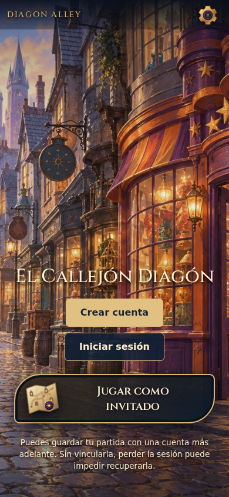
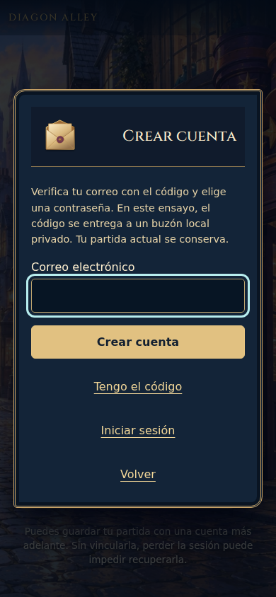
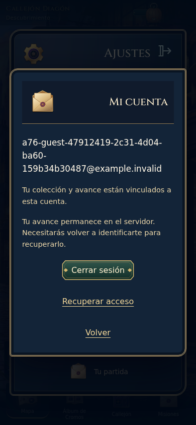

# A76 · Evidencia visual seleccionada

CI Linux39070225878, código3f6e1223d7b9ada6cae55f50f7b2627f2c35100b, checkout merge bc8c166ab38132c7c0e8e471a7206973c25dd151. Árbol idéntico c755d7debc31728151af02629b2c08c024a20cb6. Tres capturas explícitas Chromium390×844/ES/Diagon, inspeccionadas por el coordinador; sin capturas locales nuevas. Los otros tamaños, pack e idioma tienen aserciones DOM/operación en la matriz, no una captura de cada combinación.

Escenario y marca conservados; acceso cuenta/entrada y portal invitado diferenciados. Ayuda de invitado visible, Ajustes accesibles. No es evidencia de comprensión humana.

Campo nativo con etiqueta, foco visible y explicación del buzón local real. Se conserva la dirección ilustrada con ui.missions, sin generar arte. El foco cian es un estado de teclado, no un borde ornamental añadido. Desplazamiento para texto ampliado comprobado mediante DOM; no se oculta contenido para encajar.

La dirección ficticia larga se ajusta sin desbordamiento. Cuenta y controles fuera del HUD; sesión de fondo y cierre del modal mantienen retorno accesible. No hay credenciales reales o tokens en estas imágenes; los UUID pertenecen a destinatarios ficticios de la prueba.

[Resultados A76](evidence/linux/accounts-results.json):30correctos/30omisiones deliberadas por proyectos repetidos,0fallos/0flaky;84,8s. Recorridos completos muestreados en Chromium390 para ES/EN×ambos packs; formularios/foco/reflujo en ambos motores y los tres tamaños. No es dispositivo físico, lector hablado, gestor de contraseñas real o evidencia de animación.

El JSON de resultados conserva casos, tiempos, configuración, errores y estadísticas. Se eliminó únicamente metadata gitDiff repetida, que truncaba y duplicaba código ya versionado; [procedencia y hashes](evidence/linux/report-provenance.json). El artefacto original permanece en CI.

Las capturas anteriores de los candidatos34b22de/a542ef9/3da3f58 se conservan en sus artefactos CI. No se sobrescribe A75 ni se atribuye su evidencia a A76. El primer candidato se detuvo por contrato de fixture; el segundo por sincronización de prueba; el tercero descubrió publicación parcial en el buzón, corregida con escritura privada y rename atómico.
