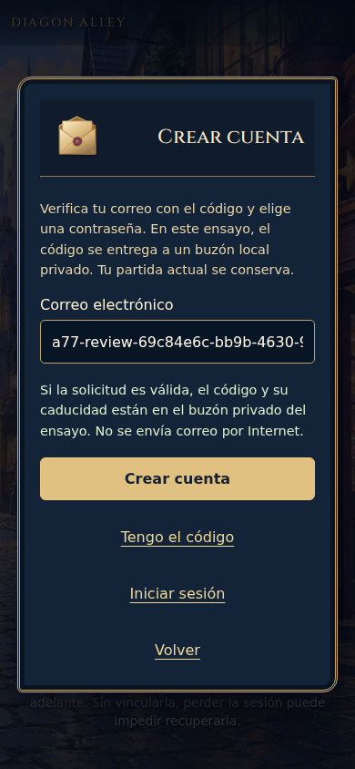
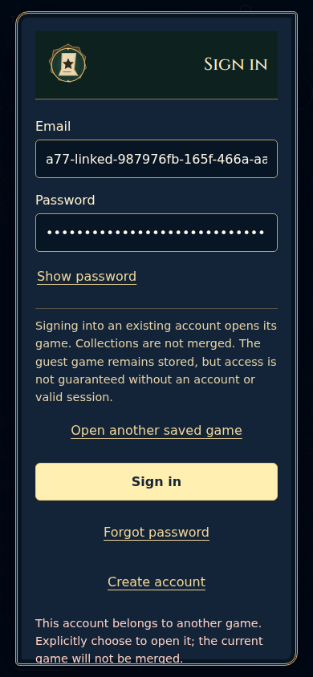

# A77 · Galería seleccionada y anotaciones

Inspección del coordinador: tres PNG previos A76, doce PNG nuevos de CI 39081730688 y uno de confirmación CI 39082151180. Ninguna captura local. No son mockups, pruebas con personas, vídeo o evidencia de articulación/animación. Fuente y límites enQA; head y checkout en los JSON de procedencia.

| Imagen | Contexto real | Observación |
| --- | --- | --- |
| [Bienvenida](evidence/linux/first/chromium-1280-a77-welcome.png) | Chromium 1280×900/EN/ARCANA | Escena protagonista; tres opciones diferenciadas, portal invitado más grande. |
| [Login](evidence/linux/first/chromium-1280-a77-login.png) | Chromium 1280/EN/ARCANA | Carta y campos legibles; cierre superior visible aquí. |
| [Registro en curso](evidence/linux/first/chromium-390-a77-mail-sent.png) | Chromium 390×844/ES/Diagon | **Conectando**, aunque nombre de archivo diga mail-sent; no estado aceptado. |
| [Solicitud aceptada estable](evidence/linux/confirmation/chromium-390-a77-mail-sent-confirmed.png) | Chromium 390/ES/Diagon | Mensaje correcto de buzón local; CTA principal sigue Crear cuenta. F01. |
| [Verificación](evidence/linux/first/chromium-390-a77-verify.png) | Chromium 390/ES/Diagon | Código/contraseña legibles; falta destinatario contextual. |
| [Código inválido](evidence/linux/first/chromium-390-a77-invalid-token.png) | Chromium 390/ES/Diagon | Pide otro código sin acceso directo a solicitarlo. Ceros=fixture inválida, no secreto. |
| [Solicitar recuperación](evidence/linux/first/chromium-1280-a77-request-reset.png) | Chromium 1280/EN/ARCANA | Etiqueta Send recovery email debe corresponder al transporte real de ensayo. |
| [Nueva contraseña](evidence/linux/first/chromium-1280-a77-reset.png) | Chromium 1280/EN/ARCANA | Aparece Hide password por elección anterior; campo vacío y type=text medido. No se expone una credencial real. |
| [Pestaña antigua](evidence/linux/first/chromium-1280-a77-stale-tab.png) | Chromium 1280/EN/ARCANA | Sesión comprobada account, pero Create account continúa abierto. F04. |
| [Conflicto](evidence/linux/first/chromium-390-a77-conflict.png) | Chromium 390/EN/ARCANA tras swap real | Advertencias correctas y elección explícita; error queda cortado en borde inferior. F07. |
| [Respuesta de login perdida](evidence/linux/first/chromium-1280-a77-uncertain.png) | Chromium 1280/EN/ARCANA | Consulta de sesión presente, submit excluido y recuperación completada. Esto sí corresponde a identidad incierta. |
| [Transporte de registro fallido](evidence/linux/first/chromium-390-a77-network-notice.png) | Chromium 390/ES/Diagon | Pide Comprobar sesión pero ese control no existe en este estado. F02. |
| [Texto200%](evidence/linux/first/webkit-865-a77-verify-200.png) | WebKit 865×1079/ES/Diagon | Texto grande refluye sin overflow horizontal; no certifica todos los formularios/lector. |

## Dos detalles prioritarios

La carta conserva el acabado ilustrado sin hacer ilegibles los campos. El siguiente paso debe pasar a ser protagonista; no se arregla añadiendo un borde o partículas.

No ocultar las advertencias para encajar. Agruparlas, mover el error junto a la acción que lo resuelve y mantener desplazamiento accesible. El diagnóstico registra error fuera del rectángulo visible en390 y dentro en1280/865.

Las tres capturas originales de bienvenida/registro/gestión ES390 están en[A76/GALLERY](../accounts-2026-10-17/GALLERY.md), con sus SHA. No se sobrescriben. Ni estos PNG ni los tests demuestran comprensión, personalidad percibida o diversión.
