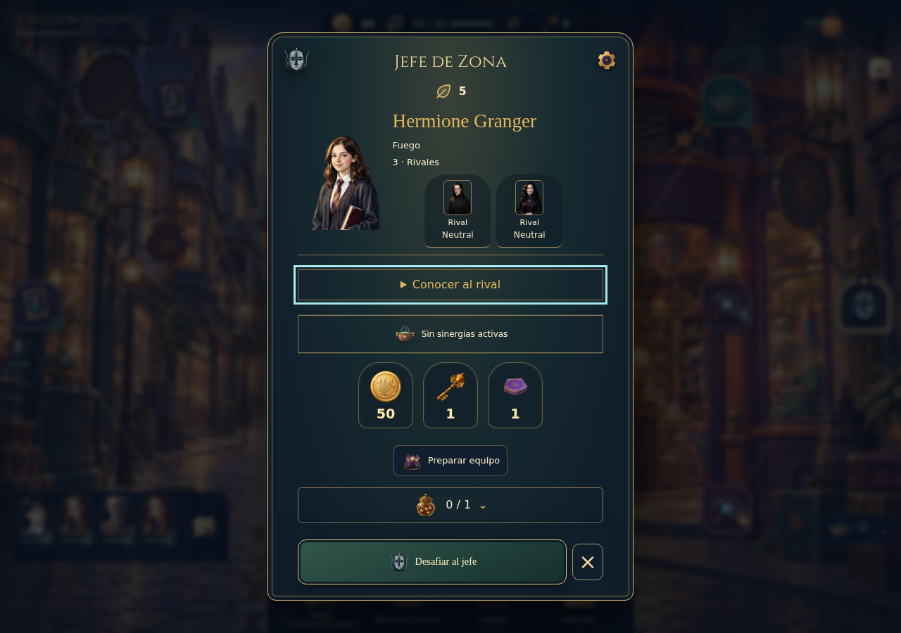
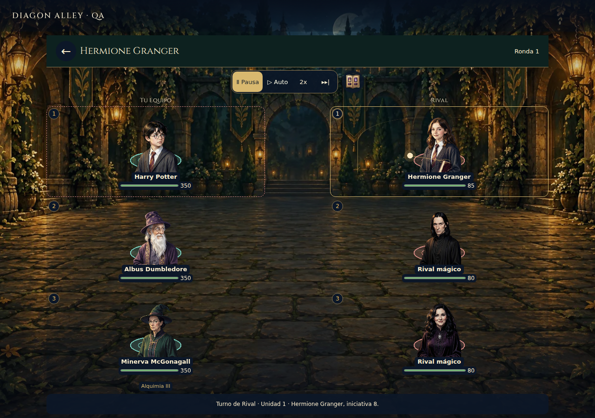
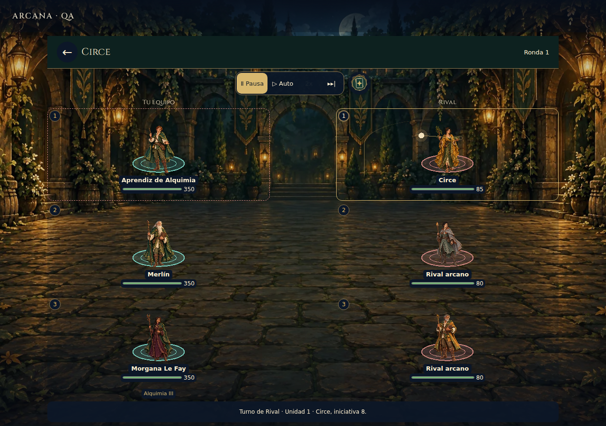
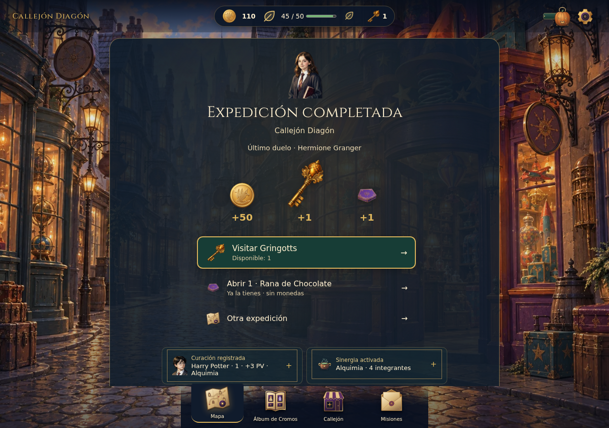

# A70 · Evidencia seleccionada e inspección

CI Linux [38977202497](https://github.com/earandes/diagon-alley/actions/runs/38977202497), candidato `0189d3a`, merge ensayado `024e88dd21fbb6274a3756133d80043f49014f81`. Cuatro capturas explícitas de Chromium1280×900, sin vídeo, trazas o captura automática de la matriz. No se ejecutó navegador local. Inspeccionadas el17de octubre, hora de Madrid.

Una captura demuestra composición en ese instante, **no movimiento**. Las fases y transformaciones efectivas, pausa, velocidad, omisión y limpieza se comprueban por separado en los tests y JSON. La matriz incluye390×844 y865×1079 en Chromium/WebKit mediante geometría y acciones; no se presenta esta selección de escritorio como inspección visual móvil o dispositivo físico.

## Consultar y preparar

Recorrido con cuenta aislada y autoridad real: formación de Descubrimiento desde su snapshot. Una sola figura protagonista, dos acompañantes, Fuego sin falsa sinergia, coste5 y botín de primera victoria. Equipo, grageas, confirmar y cancelar quedan visibles. La prueba comprueba scroll inicial0 y que los accesos no quedan bajo el pie fijo. El foco visible está en «Conocer al rival» porque se abrió/cerró con teclado antes de capturar.

La [iteración anterior](evidence/iteration-2536b25/before-header-compaction.png) sirve como comparación del defecto corregido: el gran emblema y el tamaño heredado de acompañantes empujaban preparación bajo el footer. Es evidencia A70 intermedia, no una captura nueva de A69. La referencia anterior al incremento procede del commit base y de su CI documentada, sin ampliar gráficos en el Mac.

## Libro: lanzamiento confirmado

Fixture de presentación declarada: jugadores conPV350 para observar fases, tres rivales del plan real de Descubrimiento. No es balance de campaña ni premio real. Escena pausada dentro del `spell-cast` del líder; todas las figuras yPV permanecen. El libro aporta el origen del lanzamiento y piezas recortadas independientes. El cuerpo conserva su pintura plana; no hay articulación anatómica o nueva pose corporal.

## Cuenco: misma fase tras cambiar paquete

La misma fixture y fase pausada después del swap. La prueba observa escalas reales del Sprite, no solo una fase calculada en un modelo. La superficie es pequeña a esta escala; el origen y señal local ayudan a leer el lanzamiento, pero su presencia percibida necesita observación humana. No se amplían partículas o texturas para simular una aceptación estética.

## Cierre y siguiente acción

Victoria de la cuenta de ensayo: identidad del adversario guardado,50coronas, llave y rana confirmadas. Visitar Gringotts ocupa la prioridad; abrir la rana poseída indica que no cuesta monedas. Dos hechos consultables propios aparecen después de esas acciones. El HUD muestra saldo vigente; sus cantidades dependen de la ruta de ensayo, no son una promesa de saldo inicial o una nueva tabla de premios. La captura espera al asentamiento de la animación existente únicamente para inspeccionarla.

El recorrido automatizado continúa fuera de esta imagen: recarga exacta sin celebración, apertura sin recompra, cancelación de bóveda, canje único, intención viable y nueva expedición confirmada. No se atribuye ese recorrido a un jugador humano.
