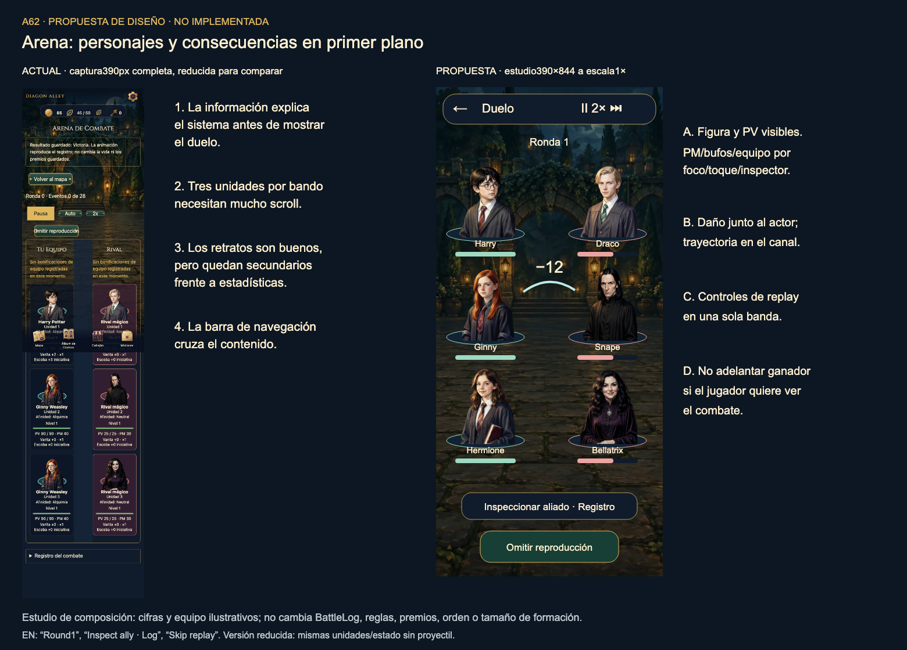
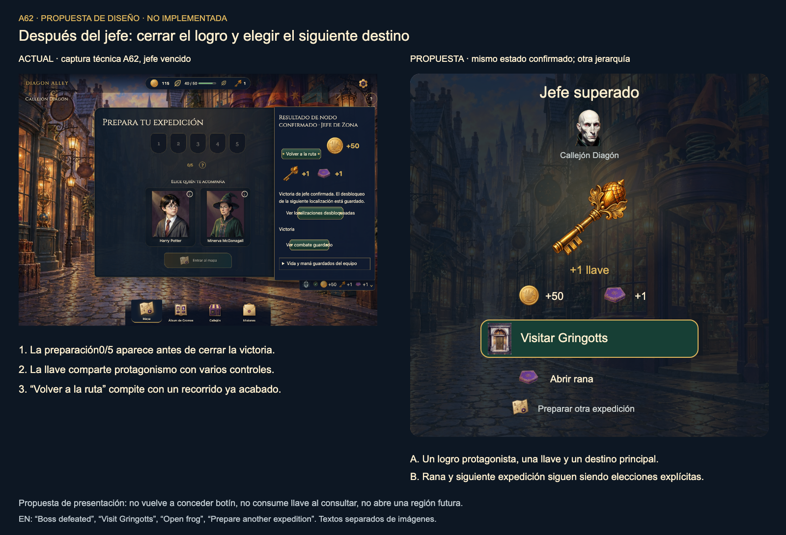
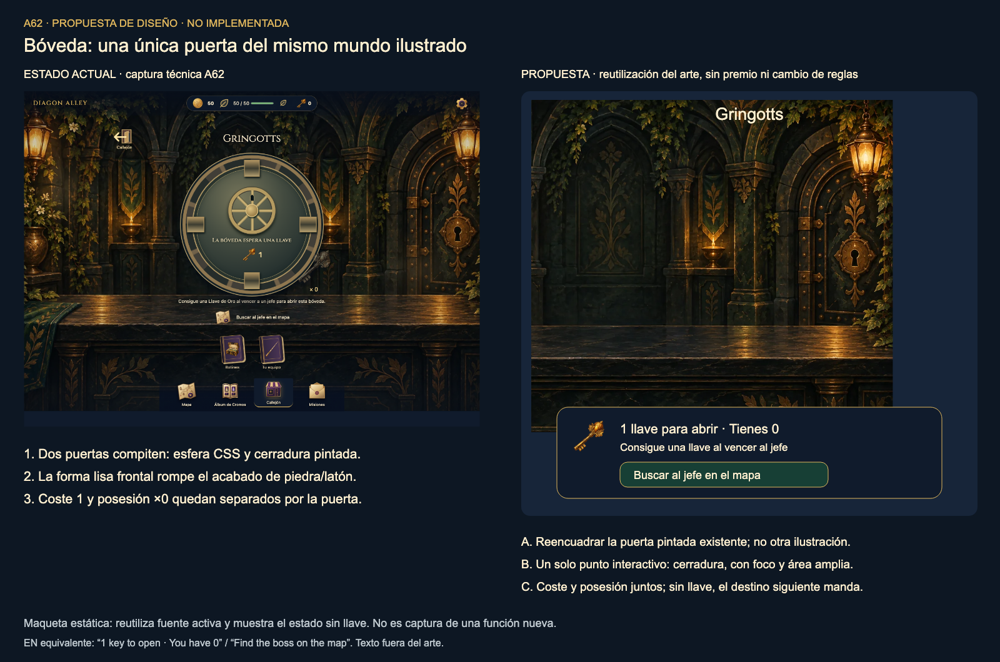

# A62 · Galería de revisión y propuestas

Las capturas de estado actual proceden de cuentas técnicas aisladas, no de usuarios. Las propuestas están **diseñadas, no implementadas**; no hay un “después” de aplicación. Los tres estudios reutilizan arte existente y sus anotaciones no son texto que deba incrustarse en el juego. [Informe](REPORT.md) · [Visor local](index.html).

## Arena

[PNG](proposals/art-arena.png) · [SVG editable](proposals/art-arena.svg) · [HTML a tamaño completo](proposals/art-arena.html). Dos bandos y PV protagonistas; stats/registro a demanda; controles agrupados; sin anunciar Victoria al iniciar. Mockup3vs3, cifras ilustrativas:5vs5 necesita diseño/validación posterior.

## Cierre tras jefe

[PNG](proposals/art-boss-closure.png) · [SVG editable](proposals/art-boss-closure.svg) · [HTML](proposals/art-boss-closure.html). La llave ganada señala Gringotts; rana poseída abre sin recompra; otra expedición sigue explícita. Mismo receipt de referencia, no nuevos premios.

## Bóveda

[PNG](proposals/art-vault.png) · [SVG editable](proposals/art-vault.svg) · [HTML](proposals/art-vault.html). Una puerta pintada con cerradura como foco. El encuadre parcial ilustra composición, no una puerta nueva terminada ni articulada.

## Pantallas actuales agrupadas

Cada imagen enlaza cuatro capturas móviles completas reducidas para revisar composición; el detalle individual está en[SCREENS](SCREENS.md). PNG originales1280×900/390×844, mapa también865×1079; una captura fullPage puede ser más alta que viewport, precisamente para documentar scroll.

## Contrastes de idioma y condiciones

- [Mapa ES](evidence/captures/es-06-map-1280.png) /[EN](evidence/captures/en-06-map-1280.png).
- [Formación ES](evidence/captures/es-18-preparation-active-390.png) /[EN](evidence/captures/en-18-preparation-active-390.png).
- [Compra gragea→destino ES](evidence/captures/es-E03-bean-destination-390.png) /[EN](evidence/captures/en-E03-bean-destination-390.png).
- [Probabilidades ES](evidence/captures/es-E02-odds-1280.png) /[EN](evidence/captures/en-E02-odds-1280.png).
- [Swap ARCANA actual](evidence/captures/es-E05-arcana-swap-1280.png).
- [Fuente200% Chromium](evidence/motion-current/chromium-map-font200.png); no zoom nativo.
- [Fixture: WebP bloqueado+reducido](evidence/motion-current/chromium-asset-failure-reduced.png); no arte ausente simulado como premio ordinario.

No se grabó vídeo nuevo. El guion de movimiento y las mediciones desde el clic se documentan en[MOTION](MOTION.md); las capturas estáticas no prueban fluidez o persistencia por sí solas.
