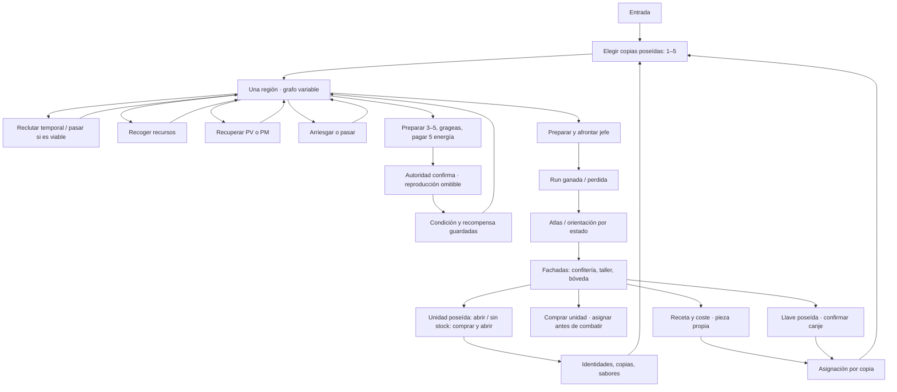

# A62 · Recorrido y decisiones

15 octubre 2026. Recorrido **técnico**, no sesión humana. Dos cuentas nuevas, español e inglés; interfaz real sobre preview compilado y autoridad local PostgreSQL/Redis. Se escogió una ruta mediante inspección del grafo para cubrir seis tipos de nodo: esta selección informada no mide descubribilidad ni dificultad de un jugador. [Script](evidence/journey.spec.ts), [resultado](evidence/journey-final.txt), [estados y cobertura](STATES.md).

## Mapa del bucle actual

Las flechas expresan recorridos posibles, no que cada uno sea obligatorio. El menú permite consultas/retornos durante una ruta. El jefe ganado finaliza la expedición; Bosque puede quedar desbloqueado como acceso futuro pero **no contiene otra campaña jugable**.

## Qué decisión sostiene cada tramo

| Tramo / captura ES, equivalente EN en evidence/captures | Intención y datos necesarios | Acción principal y alternativas reales | Consecuencia y señal de final | Motivo actual / propuesta |
|---|---|---|---|---|
| [Entrada](evidence/captures/es-01-entry-1280.png), `#/map`, `App` | Entrar al mundo; distinguir ensayo y regreso | Entrar; Ajustes sin iniciar una compra | Se carga cuenta/kit y aparece preparación | Ilustración invita; conservar continuidad de calle |
| [Preparación inicial](evidence/captures/es-03-preparation-1280.png), `ExpeditionPreparation` | Elegir quién acompaña; propiedad, condición, equipo y 1–5 puestos | Elegir copia real y entrar; consultar, equipar, cancelar | Selección explícita; servidor crea run; no entrega personajes gratuitos | Mejorar vista previa de combinación; no cinco stats permanentes |
| [Mapa](evidence/captures/es-06-map-1280.png), `MapPanel` | Elegir siguiente evento; disponibilidad, ruta y beneficio/riesgo | Solo próximos nodos alcanzables; lista equivalente, ayuda, consulta equipo | Un evento confirmado marca visita y abre conexiones | La variedad de grafo existe; falta contraste entre amenazas/ofertas |
| [Pacto](evidence/captures/es-node-pact-390.png), `NodePreparation` | Conseguir capacidad táctica; temporal frente a propio, hueco o reemplazo | Reclutar directamente; pasar habilitado según formación; reemplazar temporal si completo | Unidad `source:temporary` en run, sin copia de álbum | Recrutar completa formación; misma oferta reduce variedad futura |
| [Equipo activo](evidence/captures/es-18-preparation-active-1280.png), `TeamHud`/preparación | Entender condición, sinergia y portadores; gestionar copias propias | Consultar retrato, abrir preparación; equipo asignado por instancia | Confirmación de formación/gear, sin curación o propiedad inventada | Hacer visible qué cambia al completar una afinidad |
| [Cofre](evidence/captures/es-node-chest-390.png) | Decidir tomar botín conocido | Abrir; cancelar consulta | +10 monedas/+1 gragea en receipt | Conectar objeto a HUD y uso; no doble confirmación nueva |
| [Refugio](evidence/captures/es-node-refuge-390.png) | Recuperar recurso escaso; antes/después de cada aliado | PV o PM, descansar; cancelar | 40% máximo según regla; PV puede revivir, PM solo aliados en pie | Oportunidad real si existe desgaste; a plena condición no inventar beneficio |
| [Encuentro](evidence/captures/es-node-encounter-390.png) | Asumir incertidumbre o conservar condición | Arriesgar/pasar; consulta a demanda | Una rama guardada: monedas, curación o daño; pasar no sortea | Anticipar magnitud/categoría de riesgo sin prometer premio positivo |
| [Preparación de duelo](evidence/captures/es-node-duel-1280.png) | Comparar amenaza y preparación; ≥3 miembros, condición, 5 energía | Formar/equipar; asignar gragea; luchar; cancelar | Solo confirmar combate consume energía/grageas y guarda log | Gragea tiene lugar real aquí; compra debe orientar a este punto |
| [Combate](evidence/captures/es-arena-duel-early-1280.png), `BattlePanel` | Ver consecuencias del plan | Pausa/Auto/2x/omitir, registro; no selección manual de ataques | Reproduce BattleLog ya confirmado; devuelve al mapa | Arena simultánea, actores y PV; desenlace al resolver reproducción |
| [Recompensa](evidence/captures/es-arena-duel-result-390.png), `NodeResult` | Saber qué ganó y qué condición queda | Consultar receipt/registro; regresar | Premio y PV/PM durables; primeros/repetidos distintos | Delta y siguiente nodo, en lugar de bloque largo con botones equivalentes |
| [Callejón](evidence/captures/es-08-alley-1280.png), `BazaarStreet` | Elegir lugar por necesidad | Fachadas; regresar a mapa/álbum/misiones | Entra al interior correspondiente | Conservar mundo navegable; destacar tienda relevante solo si procede |
| [Confitería](evidence/captures/es-10-sweetshop-1280.png), `SweetshopScene` | Conseguir copia o consumible; coste/stock/azar | Producto; comprar+abrir rana o abrir poseída; comprar gragea; libros; volver | Rana confirma copia antes de animar; gragea queda sin sabor hasta uso | Compra de rana ya resuelve ambigüedad A60; gragea necesita destino preciso |
| [Rana](evidence/captures/es-14-reveal-1280.png), `CardReveal` | Descubrir personaje/rango/nueva identidad o copia | Omitir/continuar/álbum; no segundo sorteo | Caja→rana→carta→receipt estático | Mantener retrato protagonista y rareza redundante; utilidad de copia no inventada |
| [Grageas](evidence/captures/es-17-bean-assignment-390.png), `BeanAssignments` | Elegir portador antes de combate; posible beneficio o perjuicio | Asignar/quitar y confirmar combate | Unidad consumida en combate; sabor/efecto registrado | Ayuda junto al frasco es correcta; CTA actual abre preparación que no asigna |
| [Álbum](evidence/captures/es-15-album-1280.png) / [folio](evidence/captures/es-E01-album-folio-390.png) | Reconocer colección y copias; consulta sin alterar equipo | Página/filtro/folio; sabores; volver | Consultas no cambian estado autoritativo | Mantener separación colección/gestión; exceso de copias sigue sin sumidero |
| [Equipamiento](evidence/captures/es-28-equipped-1280.png), preparación/inspector | Dar pieza propia a copia concreta; bonus y exclusividad | Inspeccionar portador, asignar/retirar; cancelar | Asignación guardada; no segunda compra | Comparar antes/después y destino, evitando lista administrativa |
| [Taller](evidence/captures/es-25-workshop-1280.png), `CommercePanel` | Crear varita; madera/núcleo/coste/bonus | Seleccionar receta, revisar, confirmar; cancelar | Pieza y coste en transacción; ofrecer equipar | Mismo coste, multiplicadores dominados: primero aclarar/rediseñar elección, sin tocar tabla ahora |
| [Jefe](evidence/captures/es-node-boss-1280.png) | Prepararse para amenaza final; condición y recursos | Luchar, consultar/gestionar antes, volver | Victoria finaliza run; primera vez llave+50+1rana; repetición solo5 | Anticipar recompensa repetida real; preparar estrategia, no esperar más niveles |
| [Cierre](evidence/captures/es-19-after-map-1280.png) | Celebrar, reconocer botín, decidir uso | Hoy preparación nueva dominante y receipt consultable; Misiones ya orienta | Temporales no pasan a colección; hallazgos propios sí | Proponer llave→Gringotts, rana→abrir, otra ruta solo por decisión |
| [Bóveda](evidence/captures/es-22-vault-key-1280.png) | Usar llave conocida por botín de tabla | Consulta botín, confirmar/cancelar; sin llave buscar jefe | Consume1, entrega rama y receipt; no acceso garantizado cada repetición | Una puerta ilustrada, cerradura y botín con portador/destino |
| [Siguiente expedición](evidence/captures/es-31-next-expedition-1280.png) | Probar otra composición o buscar colección | Preparar copias propias deliberadamente | Nueva run misma región; kit y primeras victorias no se repiten | Falta objetivo táctico contrastado; nuevas regiones no arreglan este vacío |

## Retornos y recuperación observados

Se consultaron folio y probabilidades y se comparó snapshot completo antes/después sin diferencia. Cancelar la bóveda conservó llave, inventario y revisión; confirmar generó un solo canje. Forjar/equipar e iniciar otra expedición fueron comandos reales desde interfaz. Recargar al final conservó exactamente el estado, en ambos idiomas. Swap ARCANA cambió presentación conservando autoridad. [Complementos](evidence/contextual-final.txt).

No se forzaron derrota, empate, agotamiento, cinco miembros, respuesta perdida, contenido antiguo ni competencia de pestañas en el nuevo recorrido. Se distinguen código/histórico/pendiente en [STATES](STATES.md). Una comprobación de persistencia normal no demuestra esas recuperaciones adversas.

## Cómo debería evolucionar el bucle

**Ahora:** adquirir cuerpos y equipo permite vencer; la lectura de preparación y el final interrumpen su significado. **Propuesta:** hacer visibles composición→consecuencia→botín utilizable; después probar ofertas y amenazas que cambien la elección. [4585 caminos modelados](PROGRESSION.md) ganables con una política segura sin compras aconsejan no añadir poder o regiones antes de diseñar tensión. Es un resultado de modelo bajo supuestos explícitos, no una tasa de victoria de jugadores ni una prueba de aburrimiento.
