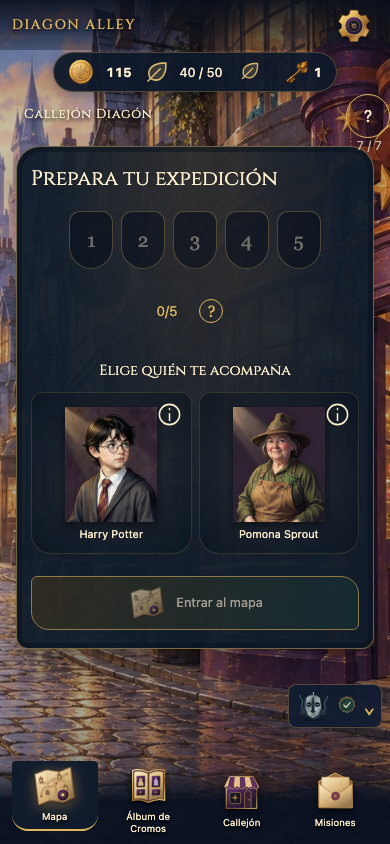
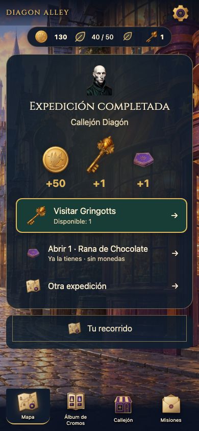
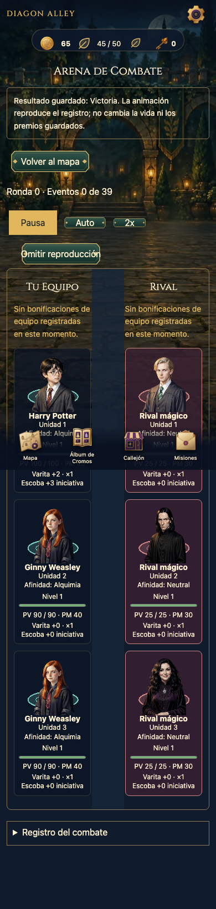
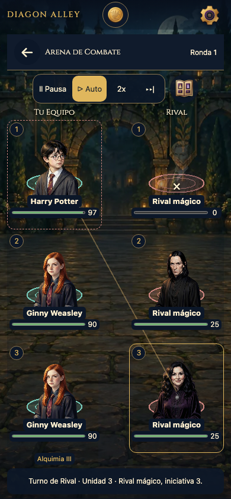
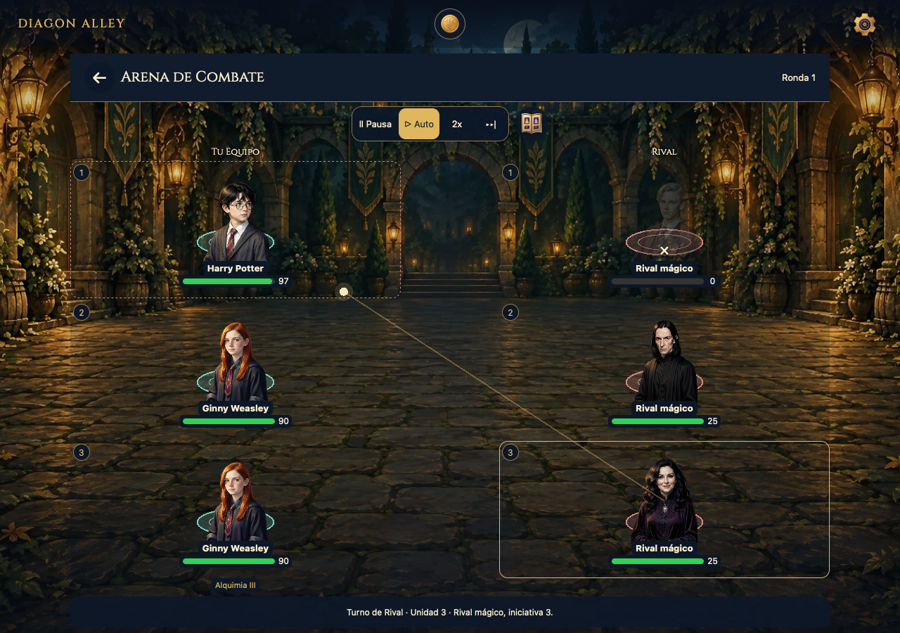
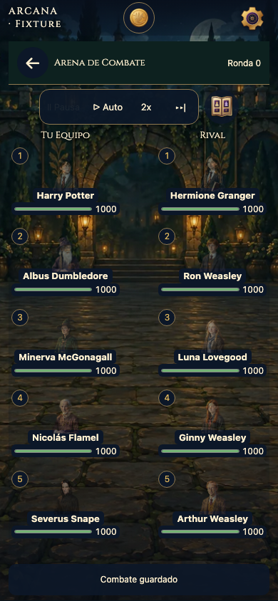
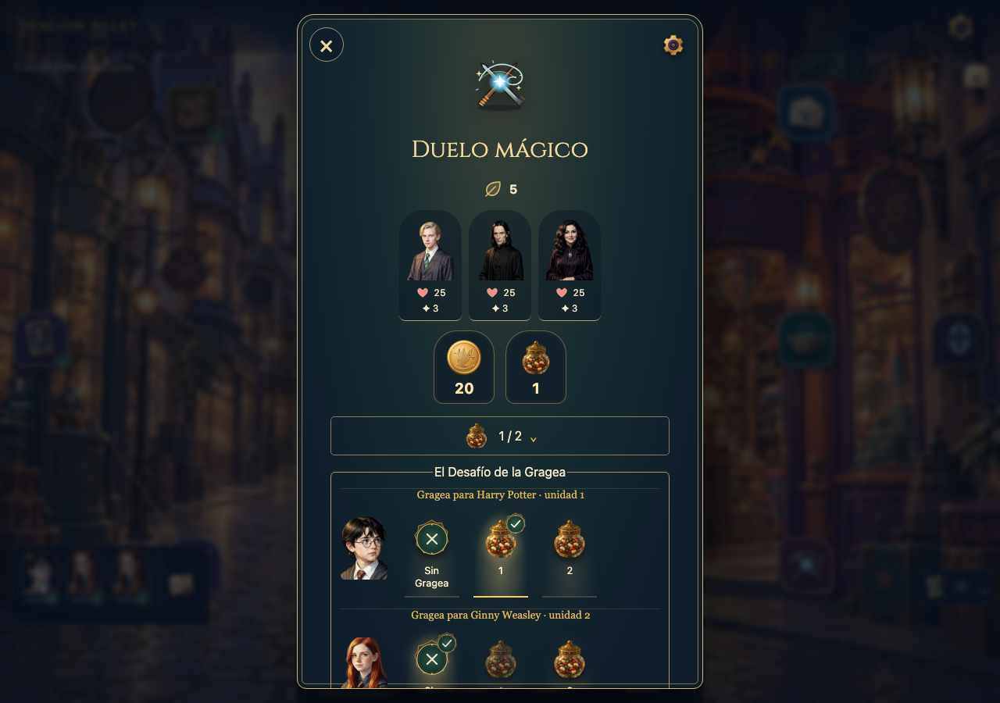
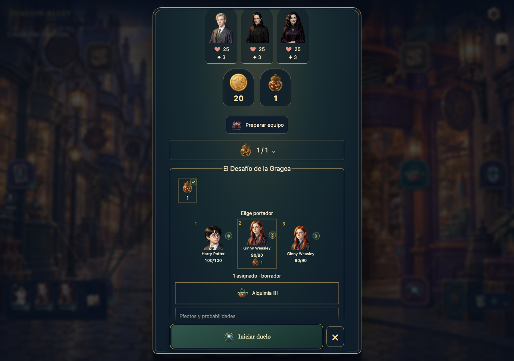
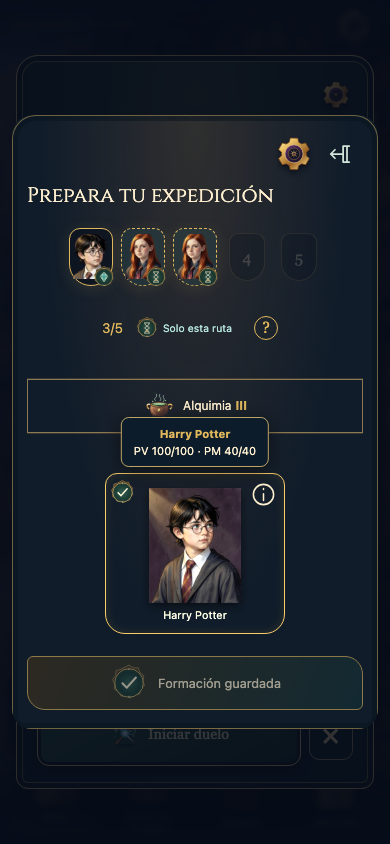
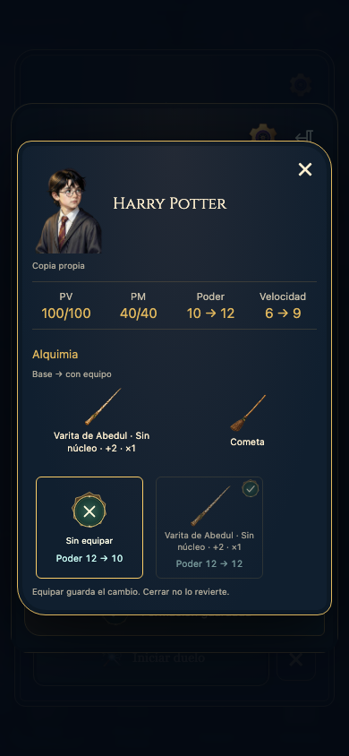

# A63 · Antes y después

Capturas técnicas de cuentas aisladas. El «antes» se volvió a ejecutar sobre el compilado previo en 5360; no se sustituyen los originales A62. Tamaños iguales permiten comparar composición, aunque recompensas aleatorias/personajes obtenidos no tienen por qué coincidir. Pruebas de escritorio y emulación; sin dispositivo físico ni sesión humana.

## Cierre

Antes: volver del jefe presenta preparación vacía como centro.

Después: resultado, botín confirmado y un destino útil; siguiente run solo por elección.

## Arena

Antes: columnas extensas, información permanente y desenlace prematuro.

Después: ambas formaciones y PV, actor/objetivo y control compacto en una pantalla. Capturas reales del duelo3×3.

5×5 es fixture explícita de presentación, no nueva campaña:

## Preparación

Antes: selector de asignación repetido por portador.

Después: tarro→portador; confirmar/cancelar visibles mientras el contenido conserva scroll accesible.

## Vídeos

- [Antes: recorrido ES completo](evidence/videos/before-es.webm).
- [Cierre → uso de botín → siguiente formación](evidence/videos/closure-and-loot-es.webm).
- [Arena5×5: fixture declarada con inspector y desenlace](evidence/videos/arena-fixture-5x5.webm).
- [Compra → contexto → portador → combate → sabor](evidence/videos/preparation-es.webm).

Grabaciones técnicas de contextos aislados, sin narración humana o prueba de diversión. Capturas/JSON de estado y tests sustentan persistencia; el vídeo por sí solo no demuestra atomicidad.
