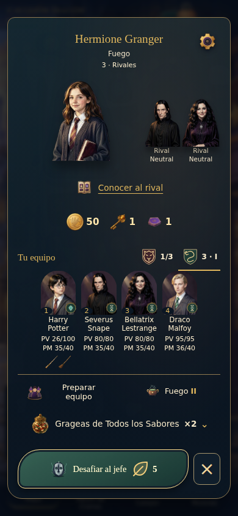
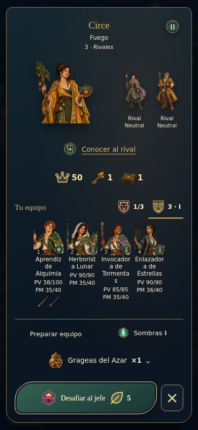
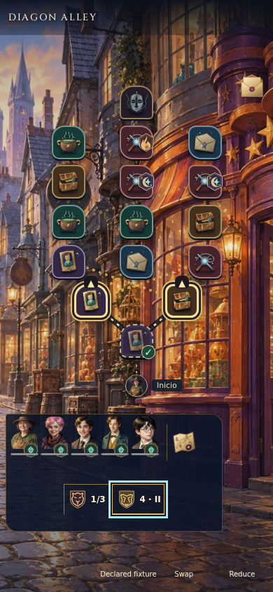
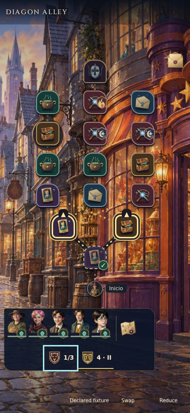
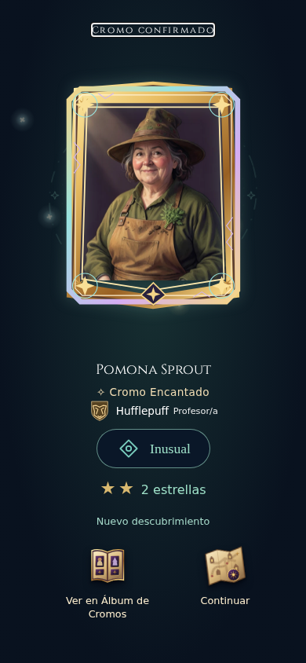
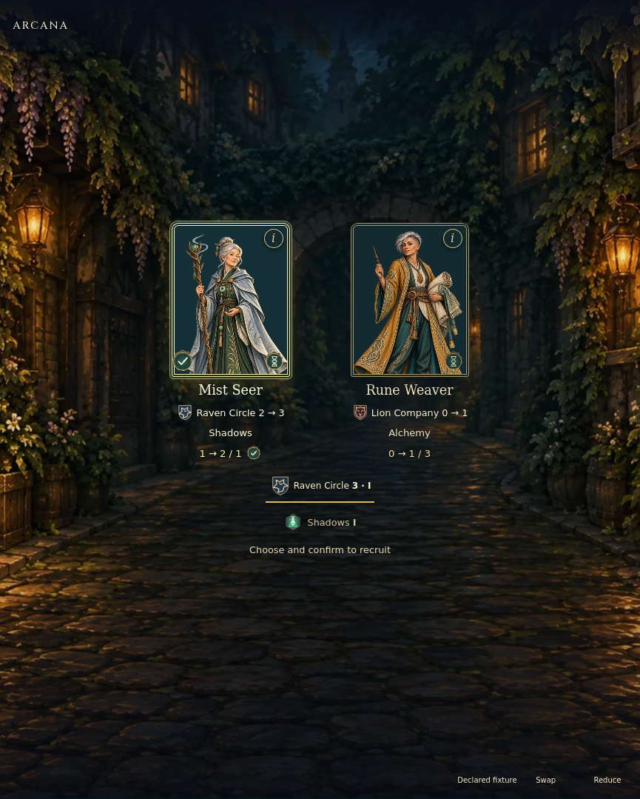
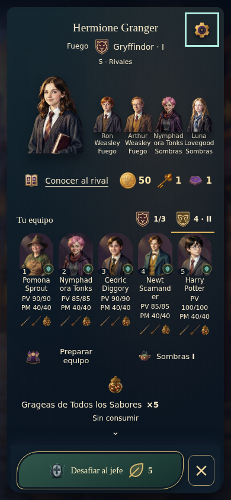

# A85 · Evidencia visual seleccionada

Sin navegador o capturas locales. PNG producidos explícitamente enCILinux con las protecciones originales; inspección posterior del archivo, no captura del Mac. Ninguna imagen acredita movimiento, persistencia, comprensión o dispositivo físico por sí sola.

## Candidato combinado actual · preparación real y arena

Fuente6cf2ac8/checkout0d59c610, CI39167929972. Ambos jobs completos superados; integrado en main mediantePR9. Imágenes seleccionadas deLinux, inspeccionadas por separado: [preparaciónDiagon](../arena-scene-2026-10-18/evidence/focus-candidate/selected-preparation-mobile-diagon.png), [preparaciónARCANA](../arena-scene-2026-10-18/evidence/focus-candidate/selected-preparation-mobile-arcana.png), [arenaDiagon](../arena-scene-2026-10-18/evidence/focus-candidate/arena-diagon-alley-390.png), [arenaARCANA](../arena-scene-2026-10-18/evidence/focus-candidate/arena-arcana-390.png). Todas las unidades/nombres/PV visibles. El foco de teclado cian se conserva. La arena es fixture declarada; la preparación procede del recorrido conectado A71, no de una cuenta habitual.

## Evidencia histórica · preparación real con autoridad, ambos paquetes

CI39150545527, fuente e352a2e, checkout0ffa2a9a1d8a342bea99982a19b4f730be17c2b2. Capturas originalesA71 `selected-preparation-mobile-diagon/arcana.png`, ejecutadas en la matrizA70 vigente. Cuentas aisladas creadas por la API/PG/Redis; no colección de una persona. Son expediciones/semillas distintas, no un antes/después del swap de la misma partida; la invariancia al cambiar presentación se comprueba en los ensayos correspondientes. Cada fuenteJSON guardaSHA, viewport, cancelación sin gasto y receipt inmutable.

Observación visual experta: rival y acompañantes tienen jerarquía; los retratos propios conservan nombres y condición; los medallones comparten el título y el tarro queda sobre la acción de combate. Las cifras de casa no tienen un rectángulo de formulario. El foco cian, cuando aparece en un libro u objeto, es estado de teclado y se conserva.

La lectura de las fuentes importa: la configuración actual redirige las capturas aA71 y desactiva nuevasA70. El artifact incluye PNG históricosA70 (`selected-boss-preparation.png` con interfaz anterior0/1), **que no se usan como evidencia actual**. Se verificaron configuración, llamadas de captura yJSON del recorrido antes de seleccionar estas imágenes.

## Mapa antes del ajuste de margen

CI39138141861/source218389c, fixtureA85 declarada (30identidades más copia), Chromium390×844 ES/Diagon, primer nodo ya visitado. No es una cuenta ganada. El margen global de `details` añadía40px por fila al grupo; se contrastó conCSS y con los fallos de preparación. La reserva de mapa mantenía los nodos utilizables, pero dejaba espacio vacío innecesario en el equipo.

Las muestras nuevas siguientes proceden de cdc909f/CI39146932044; esa ejecución falló únicamente en el caso denso del jefe. Mapa, apertura yPacto pasaron. La comparación no atribuye al estilo la distinta posición del foco de teclado que provoca la consulta exclusiva.

## Lectura y límites

- La identidad ilustrada se conserva con retratos/fondos existentes. Las cuatro insignias son UI vectorial propia, no nuevos cuadros de personajes.
- El Cromo Encantado distingue acabado de rareza/estrellas; no muestra potencia adicional ni otro personaje. La espectacularidad percibida y lectura inmediata de sus símbolos siguen siendo hipótesis humanas.
- Las pruebas temporales y su registro de posiciones complementan las capturas; los fallos y cantidades no se ocultan tras una galería favorable.

## Mapa, acabado y Pacto comprobados

Fuente cdc909f/CI39146932044; fixtures declaradas sin concesiones de servidor, con estado confirmado inmutable en el ensayo. Observación seleccionada, no cobertura artística de todos los personajes.

Las siluetas y las cifras se leen junto al grupo, sin otro panel permanente. El foco cian deGryffindor en la muestra es teclado y se conserva. El marco facetado rodea el retrato original sin cambiar identidad, rareza o estrellas. ElPacto representa selección/comparación dentro de un harness, no una incorporación persistida; las pruebas conectadas ySQL verifican esa operación por separado.

### Evidencia temporal

[Resumen y12posiciones por cada motor/tamaño](evidence/sixth/trajectory-summary.json): Hufflepuff produce12offsets distintos en cada una de seis muestras, con BattleLog inmutable. El test de revelación registra cambios de transform/opacity durante24frames, después resultado finito; omisión/recarga/reducido conservan la copia. No se infiere movimiento a partir de estosPNG ni se afirma que los otros tres perfiles se hayan observado visualmente en ejecución; tienen pruebas deterministas de la función y comparten renderer/reloj.

## Muestra densa rechazada durante la revisión

[Captura no aceptada](evidence/seventh/fixture-before-dialog-style-parity.png), [cajas y estado](evidence/seventh/status.json). e352a2e/CI39150545527 superó el job `check`, pero esa fixture carecía del CSS compartido del diálogo y elPNG mostraba retratos propios vacíos. No se usa como prueba de acabado correcto. La siguiente revisión carga el mismo diálogo/contexto delApp y exige decodificación y cajas/visibilidad de las cinco imágenes antes de capturar. Una ejecución verde no sustituye la inspección visual.

## Muestra densa corregida e inspeccionada

CI39153964079, fuente eb0c050, checkout b057556dcea4db87f8e3da7984a9151eed5a9d12. El job `check` pasa completo; regresión general todavía en curso al registrar. La fixture ahora carga CSS/contexto/acción delApp; espera decodificación y pintura y verifica cajas reales y fila de acción.

Observación experta: las cinco caras son visibles, nombres y condición permanecen, equipo y asignación aparecen sobre cada portador, libro/botín comparten estante y el coste acompaña a una sola acción. El foco visible está sobre Ajustes y no se retira. El jarro y ambos controles de preparación permanecen encima del pie; el mínimo margen medido es10,71875px en WebKit390 ES/Diagon. No se deduce de una caja la pintura de una imagen: también se inspeccionó elPNG nuevo.

[24 muestras densas y cajas](evidence/linux/dense-preparation-summary.json), [seis muestras temporales vigentes](evidence/linux/trajectory-summary.json). Las capturas actuales de [mapa](evidence/linux/map-390-es-diagon.png), [acabado](evidence/linux/enchanted-390-es-diagon.png) y [Pacto](evidence/linux/pact-865-en-arcana.png) se inspeccionaron igualmente y conservan la composición previa. La muestraPacto sigue siendo selección de harness; no se presenta como incorporación real.

Los nombres largos pueden partirse en varias líneas a cinco puestos: se conserva la información y no se afirma lectura cómoda en teléfono físico o lector hablado sin probarlos. Esta entrega técnica no acredita comprensión, diversión o acabado artístico definitivo.
