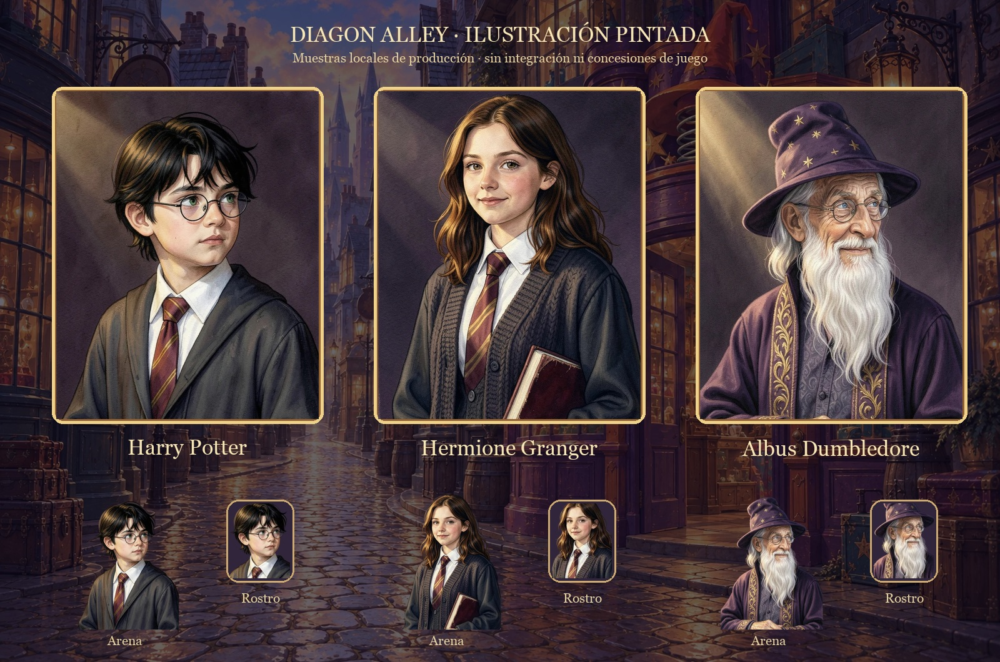
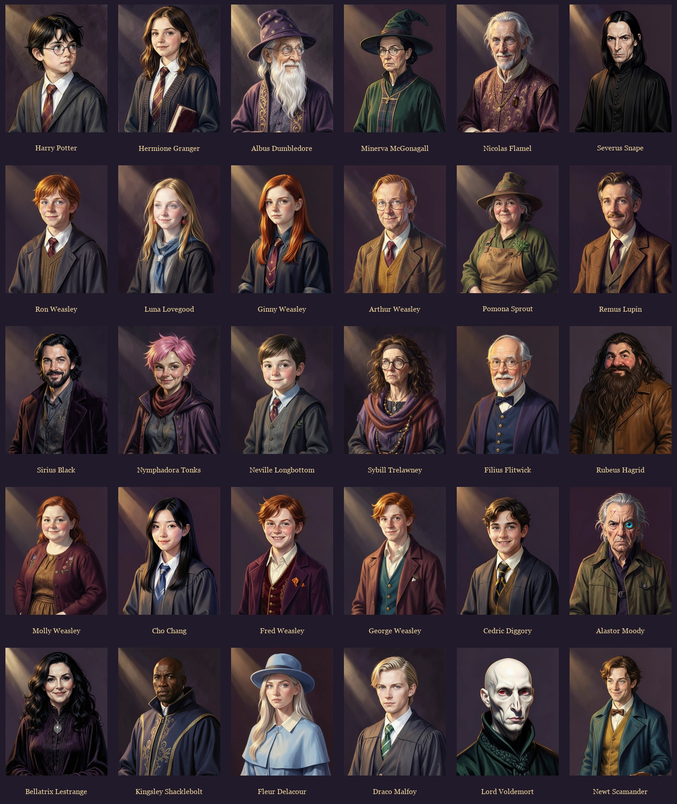

# A58 · Antes y después

La referencia A57 se conserva intacta. Los maestros/composiciones y las capturas del juego se identifican por separado; una muestra de arte no acredita una recompensa o guardado.

## Antes · personaje vectorial A57

## Dirección ilustrada elegida

Composición local de tres personajes, antes de integración. Texto de maqueta fuera de los recursos runtime; no representa una colección obtenida.

## Después · evidencia integrada

Familia final: treinta personajes con tres exports por función, seleccionados en el paquete Diagon Alley. Hojas de revisión, sin representar copias ganadas:

[Figuras alpha](../../../design/diagon-alley/illustrated-v2/final-figures.jpg) · [Miniaturas de rostro](../../../design/diagon-alley/illustrated-v2/final-thumbnails.jpg).

Componente de revelación real, con recibos guionizados etiquetados de fixture para inspeccionar encuadre; no concede recompensas:

[Hagrid en carta](captures/es-frame-night-forger-1280.png) · [Familia y roles ES](captures/es-family-1280.png) · [Familia y roles EN](captures/en-family-1280.png).

Las capturas del flujo conectado de compra/apertura se conservan aparte en `qa/opening/` y `qa/game-redesign/captures/`. Ejemplo del flujo conectado compilado, con cuenta técnica aislada:

Sus pruebas comprueban operaciones/estado; no se presentan las fixtures visuales como una colección obtenida.

[Pruebas de apertura y comparación temporal](../frog-opening-performance-2026-10-15/TESTING.md).
