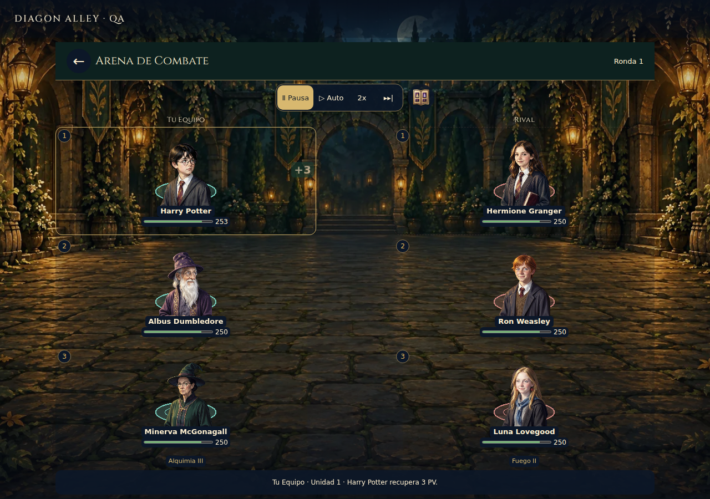
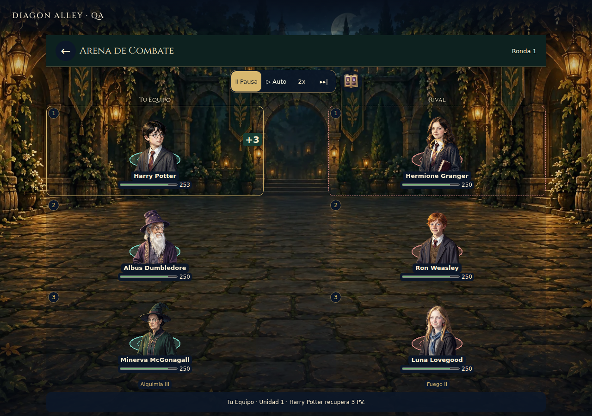
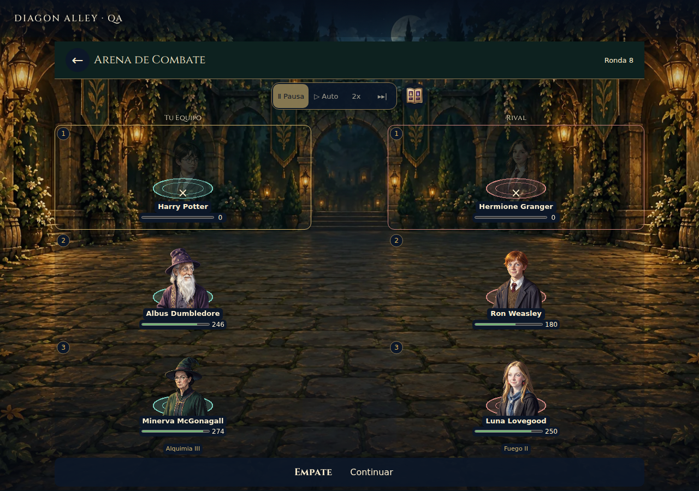

# Evidencia visual seleccionada

Cuatro capturas Linux del candidato `6910a48`, CI38959694470, Chromium1280×900. Reabiertas e inspeccionadas visualmente tras descargar el candidato final: seis figuras y PV dentro de la escena, actor/objetivo diferenciados, contacto localizado, caídos presentes y resultado legible. Son **fixtures 3×3 con estadísticas declaradas para probar la reproducción**, no una partida humana ni combate de campaña. El test completo comprueba además geometría3×3/5×3/5×5 en ambos motores, packs, idiomas y tres tamaños; esas variantes no tienen una captura por celda.

Una captura estática no demuestra ritmo o fluidez. El test observa la fase de un `spell-cast` y pausa dentro del RAF para fotografiar anticipación/contacto; la continuidad y pausa se comprueban aparte. No son un storyboard de un jugador.

## Anticipación y contacto

El cuadro de información inferior describe el último evento consumido; en estas dos imágenes conserva la curación previa mientras el siguiente hechizo se representa. Los PV se proyectan desde eventos guardados, no se recalculan por el efecto.

## Desenlace

El empate pertenece al log de esta fixture. No es evidencia de balance, dificultad o frecuencia de empate de la campaña.

## Corrección de legibilidad durante la iteración

Antes de la corrección, candidato8335ce0: el estado ya era `result`, pero las estrellas seguían parcialmente atenuadas por un fade secundario.

Después, candidato6910a48: rango y estrellas quedan plenamente legibles cuando el resultado es utilizable.

Esta pareja compara una **corrección interna de A69** con la misma fixture; no se presenta como captura de main anterior a todo el incremento. No se ejecutó captura nueva del main inicial en el Mac. El inventario anterior se conserva como evidencia de código y fuentes históricas, con sus límites.
