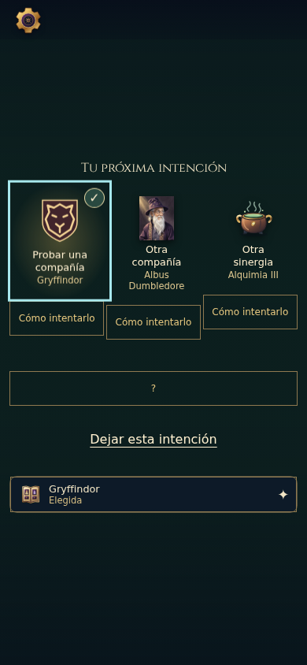
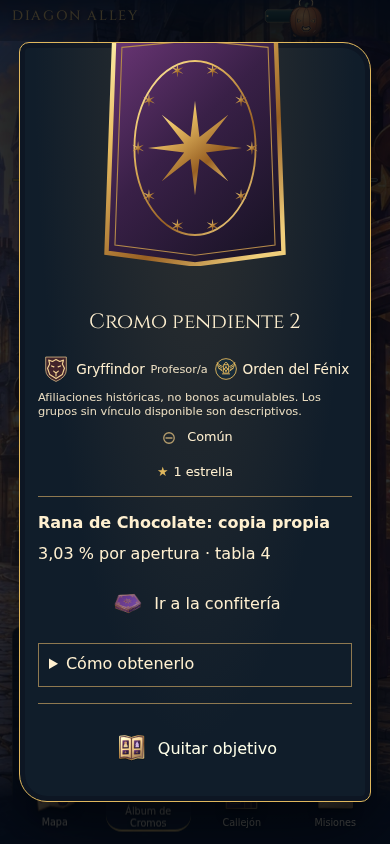
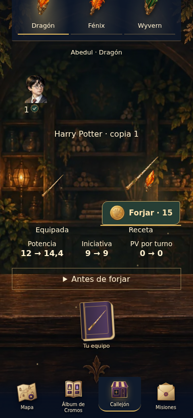
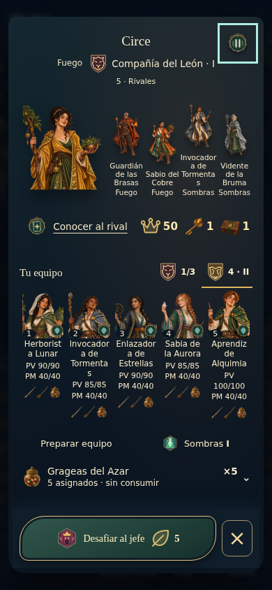

# Evidencia visual seleccionada · A89

Cinco imágenes de CI Linux39261802331, head9b2ea61/checkout200a92c (mismo árbol), Chromium390×844, español y Diagon Alley. Procedencia, SHA256 y tipo de escena en [provenance.json](evidence/final/provenance.json). Selección e inspección manual de artefactos existentes; no se abrió un navegador ni se capturó el Mac. La corrección de la guía se comprueba por límites/no solape en el caso App real a los tres tamaños y cuatro parejas; estas imágenes no representan el mapa. Tres imágenes nuevas inspeccionadas; grageas y combate idénticos por SHA256 a las muestras anteriores revisadas. La evidencia previa se conserva en evidence/attempt-6, evidence/attempt-7/ui y evidence/attempt-8/ui.

## Compañía: elegir un plan voluntario

Fixture declarada sobre componentes reales. El emblema existente conduce la elección; la explicación y viabilidad quedan bajo demanda. No prueba que una persona entienda el plan ni que esa colección haya sido ganada en campaña. Cumplimiento y recuperación se comprueban además por dominio/HTTP/PostgreSQL.

## Cromodex: una identidad como objetivo

App conectada con invitado aislado. Inspector desplazado hacia fuente/objetivo: no se interpreta el recorte superior de la carta por scroll como deformación del recurso. Se mantienen silueta, fuente real y distinción copia/temporal; el enlace posterior alcanzó Confitería sin operación económica automática.

## Varita: portador y renuncia

App conectada. Retratos con tamaño legible, copia concreta y comparación breve en la mesa existente. Elegir referencia no equipa ni forja. [Muestra previa](evidence/attempt-2/selected-forge-390.png): los retratos eran demasiado pequeños; el ajuste evita dimensiones porcentuales circulares. La muestra previa era componente/fixture, por lo que no es comparación pixel a pixel del mismo inventario.

## Gragea: stock separado del borrador

Fixture declarada de preparación. El tarro permite asignar o conservar y consultar el riesgo; no elegir un sabor ya descubierto. El foco visible permanece sobre el objeto consultado. El control auxiliar «Cancel» pertenece al harness, no es copy de producción. La cohorte App real compra/asigna y confirma el consumo mediante acciones existentes, sin inyectar inventario.

## Combate: consultar lo que sí ocurrió

Fixture5×5, diez figuras/PV y libro posterior al desenlace. Emblema de casa y hasta dos hechos registrados, sin causalidad inventada. Una captura solo acredita composición. Pausa,2x, cambio de lectura, omisión y devolución de foco se comprobaron mediante assertions temporales; no equivalen a inspección humana del ritmo.

## Corrección contrastada del tarro:390ESARCANA

Una muestra adicional explícita deCI10, fixture densa cinco aliados equipados/cinco borradores. El tarro mantiene existencias y asignación provisional sin consumir. Geometría Chromium: repisa44px y separación24px hasta el pie, frente≈113px y≈10px de invasión enCI8. WebKit también supera la aceptación original. Se conservan nombres multilínea, cinco figuras,PV/PM,equipo y coste. Esa densidad no se presenta como comprensión humana verificada. JSON y procedencia junto a la imagen; muestras desfavorables en evidence/attempt-8.

## Límites de la revisión

Las imágenes son una cohorte seleccionada, no toda la matriz. Las otras parejas ES/EN×packs y tamaños1280/865 se comprueban por comportamiento/geométrica en Linux y quedan identificadas en QA. Reflujo320/200%, import/arte ausente y propietario distinto tienen casos propios. No dispositivo físico, lector real o sesión humana. No se declara arte definitivo por pasar un detector.
