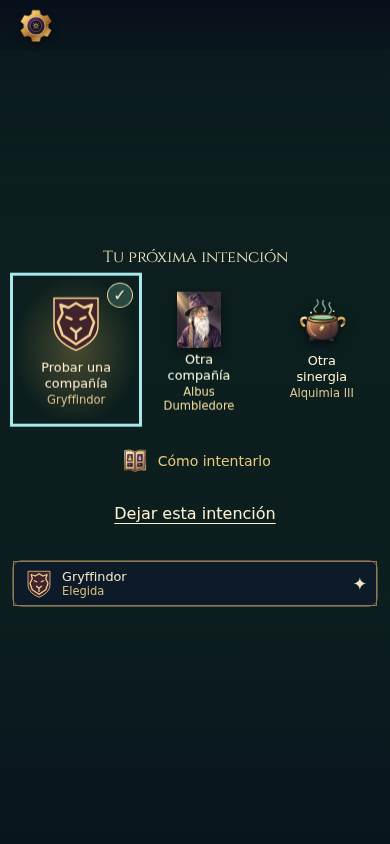
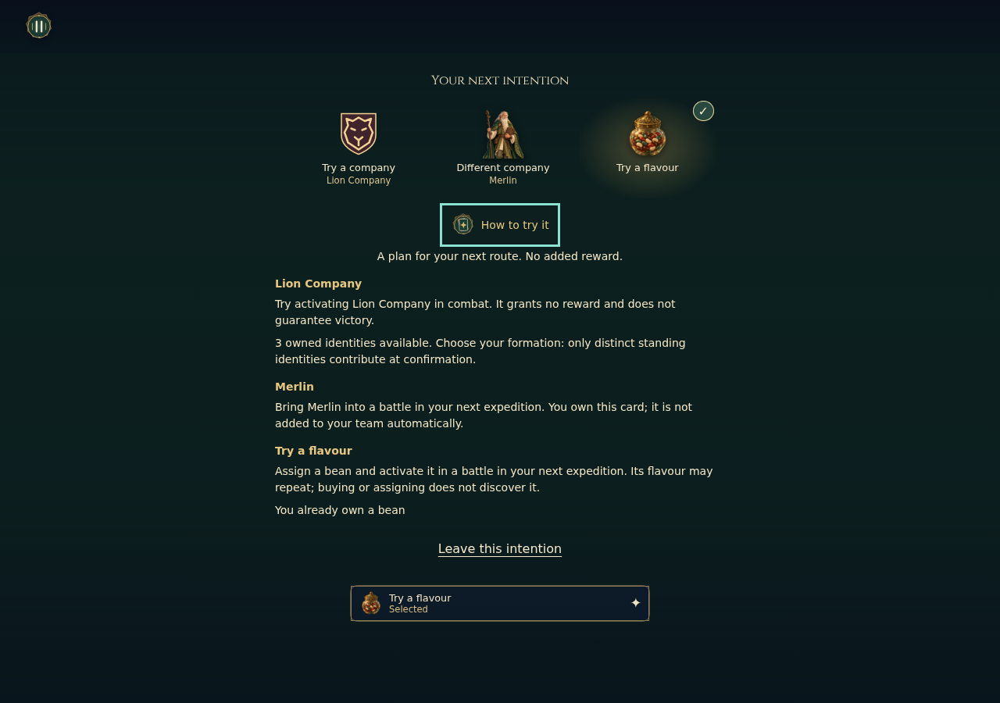
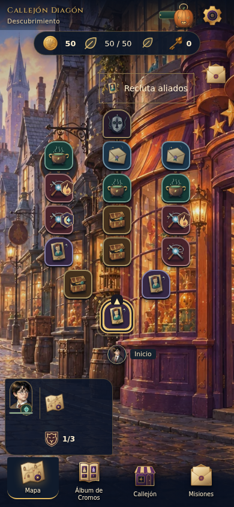
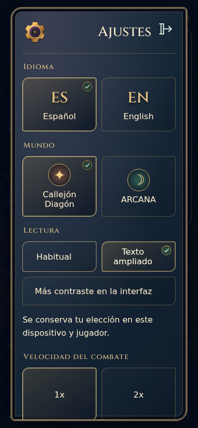
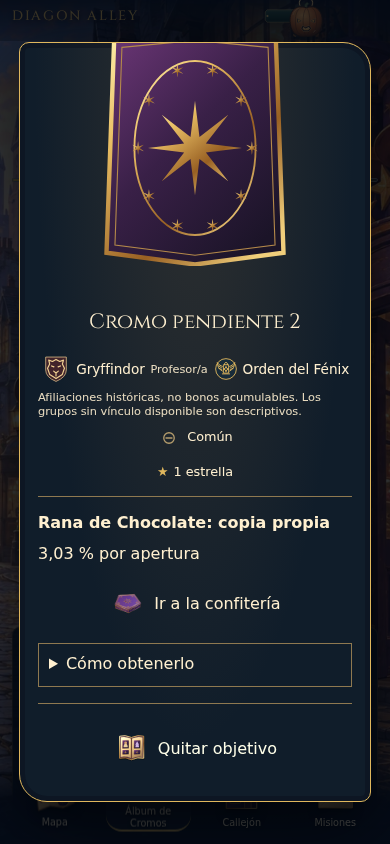
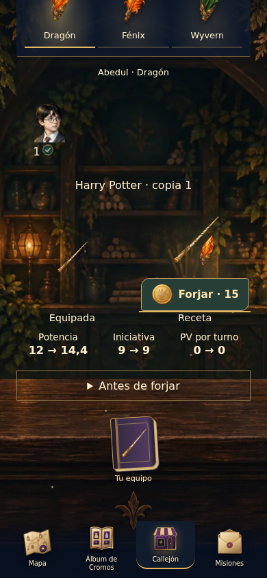
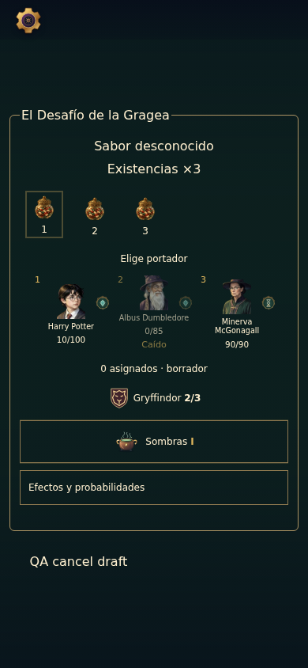
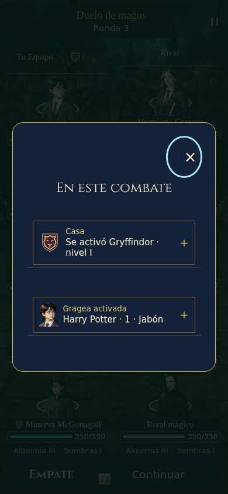

# Galería revisada · A90

Ocho capturas seleccionadas de CI Linux39280235365 sobre19f0b4f; checkout1dfca931 de árbol idéntico. [Procedencia, tamaños y hashes](evidence/final/provenance.json). Inspección de archivos existentes: ningún navegador/captura en el Mac. No matriz de capturas ni validación humana. Cian indica foco de teclado, no un marco decorativo permanente.

## Intención: tres objetos y un libro

[Antes A89](../priority-increment-2026-10-19/evidence/final/selected-company-390.png): tres ayudas rectangulares y un «?». Ahora se mantiene elección, abandono y explicación sin cuatro controles secundarios equivalentes. Mismo escudo en elección y recordatorio.

Fixture declarada de colección/resultado, no partida ganada ni pantalla completa de cierre con botín. El cierre real y su prioridad de botín conservan sus consumidores; las operaciones y retornos se prueban por separado.

## Comparar planes bajo demanda

Fixture con intención heredada de gragea, antes de cambiarla. El libro contiene todas las alternativas, disponibilidad propia y coste/necesidad de gragea cuando corresponde. Toda la explicación se consulta antes de elegir; no se confunde con formación activa. Una única columna de lectura, no tres columnas estrechas ni una configuración obligatoria.

## Orientación dentro del mapa real

App conectada con invitado aislado y kit real. La guía conserva su repisa, el mapa completo y los objetos de ruta. Es otra ruta generada, no una comparación pixel a pixel de la misma semilla. Nombre accesible, consulta/cancelación y fallback se comprueban además por assertions.

## Lectura en Ajustes: corrección demostrada

[Antes S07](evidence/attempt-1/selected-reading-390.png): tamaños apilados y contraste estirado, producidos por el grid común. Se conserva la familia visual de Ajustes; tamaños en fila, contraste debajo y sello seleccionado. Lectura ampliada sigue activa.

Fixture de arena pausada. La parte inferior de Ajustes continúa por scroll accesible. No se ocultan preferencias para aparentar que caben. En320px el grupo puede apilarse para reflujo. El fallo intermedio de cascada está preservado en [attempt-2](evidence/attempt-2/failure.json); la aceptación de geometría permanece igual y pasa sobre el candidato mostrado.

## Cromodex: fuente y azar sin versión técnica dominante

App conectada, inspector desplazado hacia la adquisición. Recorte superior por scroll, no deformación del dorso. El porcentaje exacto permanece junto a «copia propia»; la versión se consulta en «Cómo obtenerlo». Marcar/quitar y viajar a la tienda conservan sus efectos separados.

## Taller: conservar lo que comunica una renuncia

App conectada. Portador concreto, varita equipada, receta y tres comparaciones breves. Una acción pagada explícita. No se ocultan cifras iguales, porque muestran qué cambia y qué se conserva. No nueva producción de retratos/varitas.

## Tarro: objeto, portador y borrador

Fixture declarada. Stock, estado caído, selección por instancia y borrador diferenciados; efectos/probabilidades bajo demanda. «QA cancel draft» pertenece al harness, no es copy de producción. La matriz conectada prueba compra/asignación/consumo sin conceder inventario manualmente.

## Hechos después del combate

Fixture5×5. Dos hechos registrados, sin causalidad inventada ni otra pantalla de estadísticas. Se mantiene continuación fuera de la consulta, diez unidades/PV y equivalencia estática. La imagen no acredita ritmo: pausa, omisión,2x, foco y conservación del log tienen pruebas temporales separadas.

## Alcance de la aceptación visual

Veredicto experto: familia ilustrada coherente, jerarquía de objetos conservada y menos controles secundarios por defecto. No nuevo defecto bloqueante observado en esta selección final. Otros idiomas/paquetes/tamaños se comprueban por comportamiento y geometría; no se simula haber inspeccionado cada combinación visual. No sesión humana, lector real, zoom real o dispositivo físico. No se atribuye comprensión, diversión o retención a la automatización.
