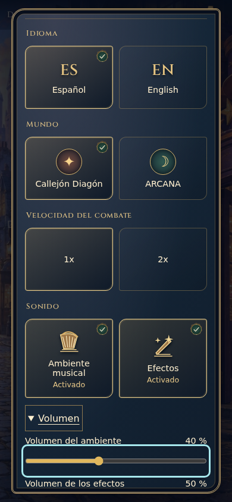

# Revisión visual acotada A88

Una captura seleccionada de CI39213910504, fuente06cc89a / checkout5c29d3f, Chromium390×844 emulado. Procedencia: `tests/browser-audio/audio-a84.html`, harness del componente real de Ajustes, sin cuenta o recorrido de campaña. No captura nueva del Mac. Batería deaudio/movimiento90correctos en esaCI; fallo independiente deA71 registrado enQA.

Observación estática: se conservan lira/varita, superficie azul y borde dorado, etiquetas fuera deilustración, sello deselección y foco cian visibles. Volumen es un rango nativo a demanda. El diálogo admite desplazamiento interior; no se convierte elmapa en configuración permanente. No nuevos botones, marco, ilustraciones o jerarquías A88.

No se presenta esta imagen como evidencia deaudio audible, movimiento o dispositivo físico. Elcaso nativo separado comprueba fuente musical activa con un efecto retenido y sin golpes atrasados; escucha y percepción requieren la sesión posterior. CSS/markupdeAjustes son idénticos entre06cc89a y28ec176; los cambios posteriores deQA no invalidan esta observación deestilo.
