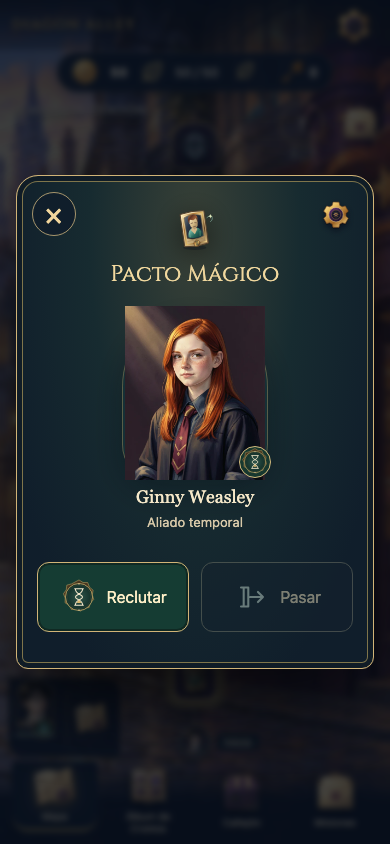
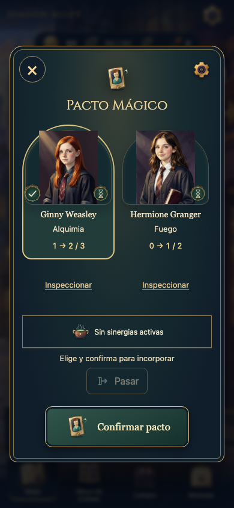
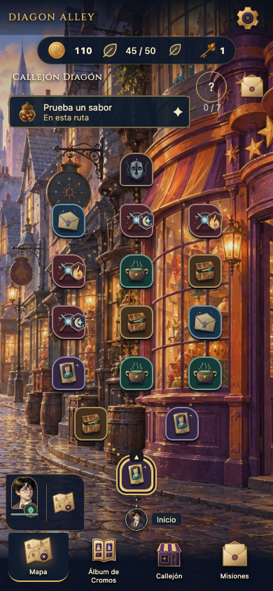

# A65 · Antes / después

Capturas reales de contextos técnicos aislados. No son mockups ni pruebas con personas. Referencia inicial nueva contra97573b0; históricosA62/A63 intactos. Finales compilados candidate3; cambio posterior exclusivo de foco inicial comprobado en regresión final. Geometrías/estado/operaciones se contrastan por separado en QA.

## Pacto móvil comparable

| Antes: un solo recluta | Después: dos alternativas y progreso real |
|---|---|
|||

[Antes1280](evidence/before/pact-1280.png) · [Después1280](evidence/after-pacts/chromium-a65-diagon-alley-es-pact-selected-1280.png) · [Después865](evidence/after-pacts/chromium-a65-diagon-alley-es-pact-selected-865.png).

## Mapa con intención y amenazas

[Mapa1280](evidence/after-intentions/chromium-intentions-a65-diagon-alley-es-active-1280.png) · [Mapa865](evidence/after-intentions/chromium-intentions-a65-diagon-alley-es-active-865.png). Las primeras capturas intermedias en evidence/ui preceden los contadores finales; no prevalecen sobre estas.

## Inspección y consecuencia

[Consulta de rivales](evidence/after-pacts/webkit-a65-arcana-en-rival-inspected.png) · [Inspector de Pacto](evidence/after-pacts/chromium-a65-diagon-alley-es-pact-inspected.png) · [Desenlace real](evidence/after-pacts/chromium-a65-arcana-es-duel-result.png).

## Vídeos conservados

- [Pactos → preparación → combate, Diagon ES Chromium](evidence/after-pacts/chromium-es-diagon-pact-to-combat.webm).
- [Pactos → preparación → combate, ARCANA EN WebKit](evidence/after-pacts/webkit-en-arcana-pact-to-combat.webm).
- [Intención → preparación → activación, Diagon EN Chromium](evidence/intentions-videos/tactical-intentions-a65-A6-c3008-on-recovery-en-diagon-alley-chromium-intentions-a65.webm).

Procedencia y matriz completa: [vídeos Pactos](evidence/after-pacts/videos.json), [ocho vídeos de intenciones](evidence/intentions-videos/manifest.json). Hay82PNG finalesPactos y72PNG finalesIntenciones; no equivalen a154sesiones o casos distintos. Capturas adicionales de regresión y fallos declarados están separadas.
