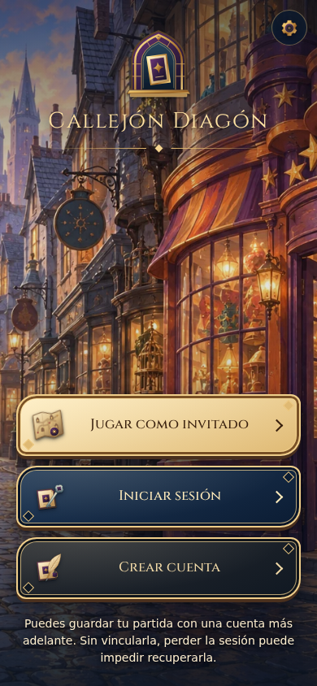
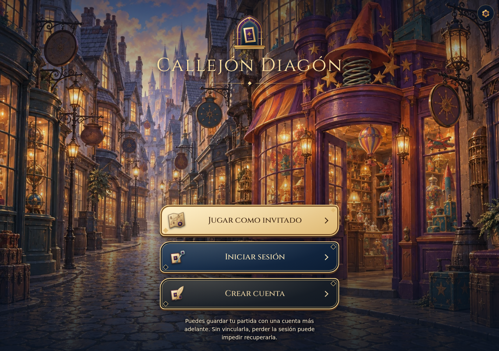
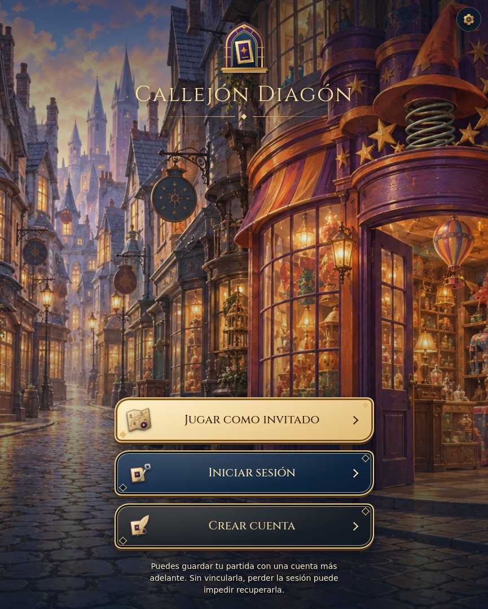
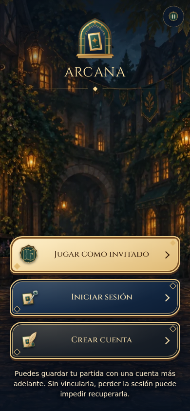
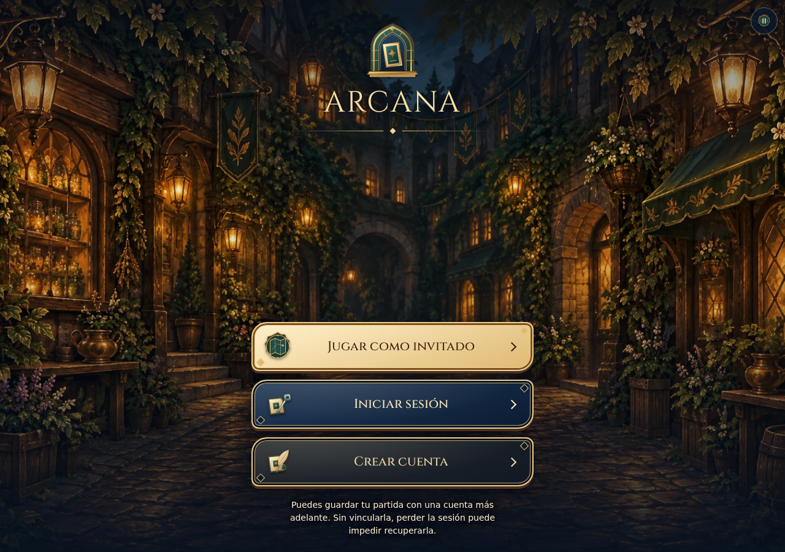
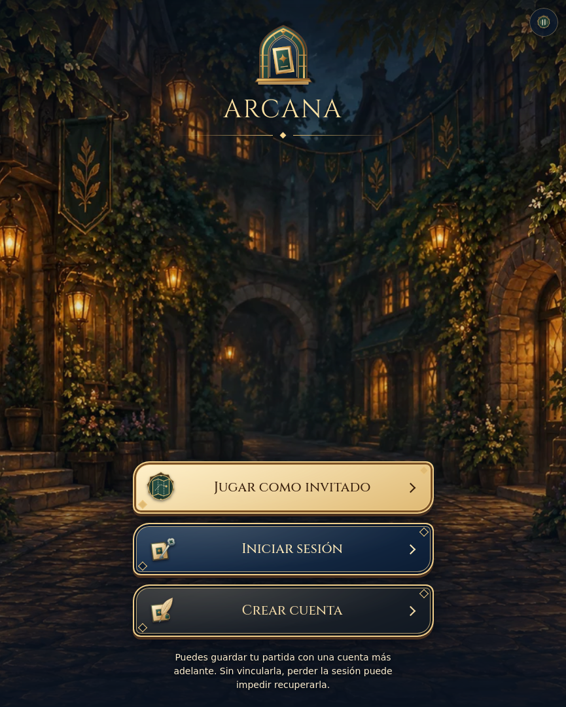
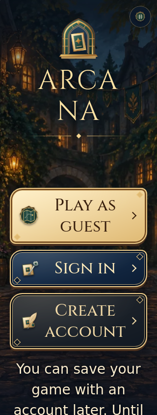

# A82 · Evidencia seleccionada

Antes: [móvil A81](../account-identity-art-2026-10-18/evidence/final/chromium-390-a81-welcome.png), c9955b4 con fuente equivalente028ac85. No es una captura nueva del baseline.

Primera inspección: [Diagon390](evidence/review/chromium-390-a82-diagon-alley.png), [ARCANA390](evidence/review/chromium-390-a82-arcana.png). Candidato82b8c82, CI39115026918. Fondo/header heredado y título160px detectados visualmente; el test inicial de geometría no bastaba. Resultado fallido conservado.

Confirmación de la corrección: f9082cf, CI39115461901, Linux. Capturas seleccionadas de Chromium390/1280 y WebKit865, ambos paquetes. Los nombres de archivo corresponden al proyecto original; enlarged se toma después de cambiar a320×844 y200% conEN/ARCANA. Captura estática acredita composición, no animación ni persistencia. No móvil físico.

La inspección confirma fondo/escenario visible, una marca y acciones de la misma familia; no demuestra comprensión humana o personalidad percibida. Datos de geometría en evidence/final/*-geometry.json; resultado6/6 enmenu-results.json.
