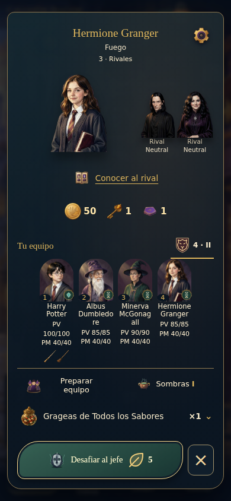
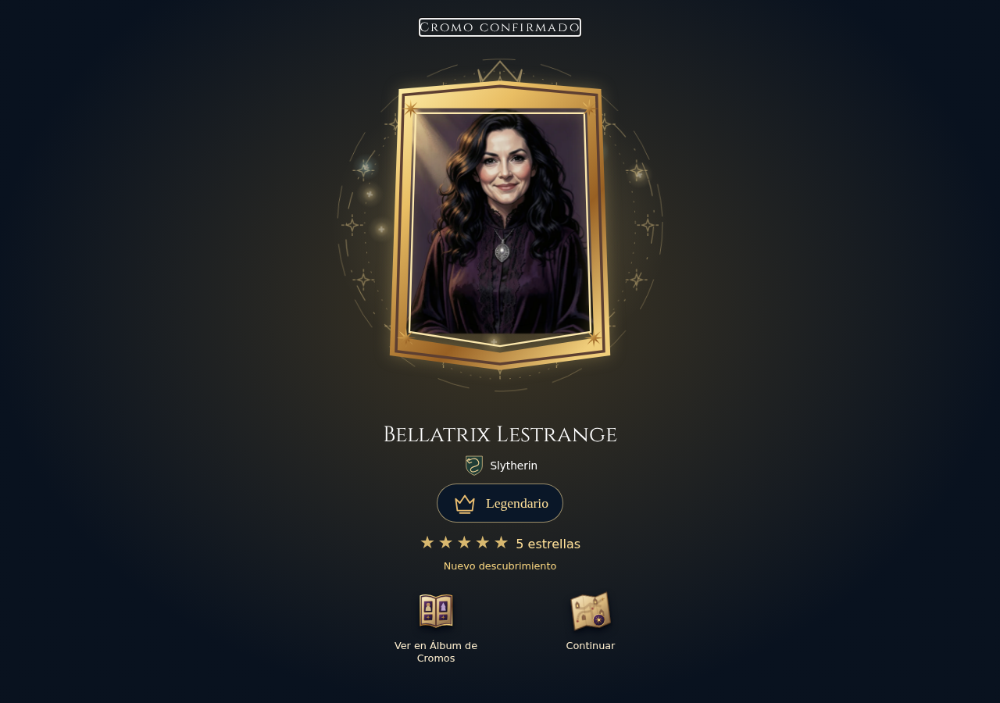
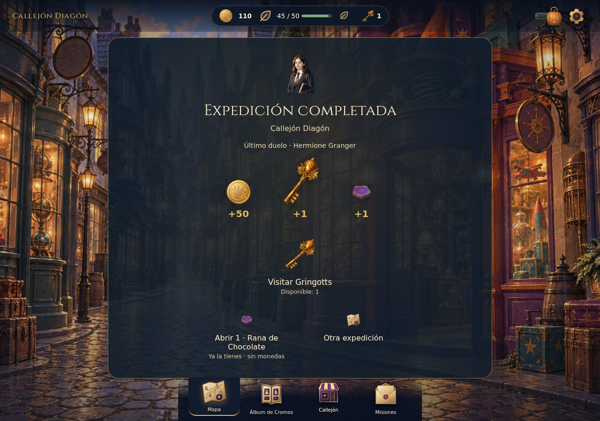
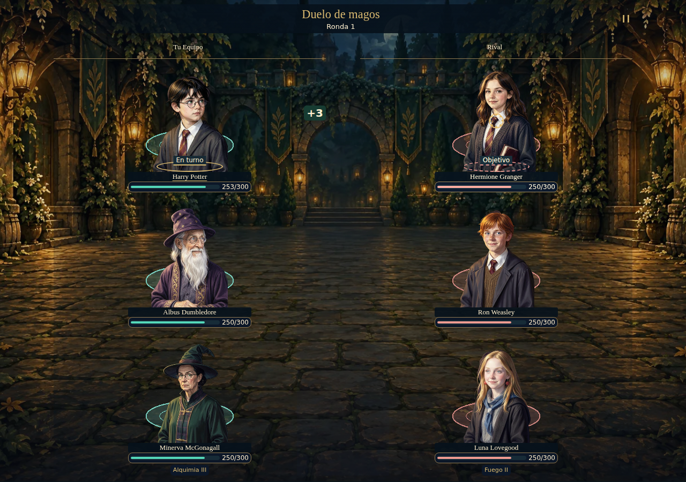

# Evidencia y procedencia

**15 PNG únicos inspeccionados** entre Assessment A y coordinador. Cuatro se copian de artefactos Linux existentes para hacer portátil la selección, sin generar capturas nuevas. El resto enlaza evidencia histórica conservada. Ningún PNG acredita movimiento, integridad de datos o comprensión.

| ID | Imagen | Procedencia y cobertura | Observación concreta |
| --- | --- | --- | --- |
|V01|[selected-guide-390.png](../priority-style-review-2026-10-19/evidence/final/selected-guide-390.png) 390×844|CI39280235365 /19f0b4f /checkout1dfca931 equivalente. Actual por equivalencia de código; fixture salvo mapa/forja conectados|Mapa y énfasis de guía; conexiones pierden peso frente al fondo.|
|V02|[selected-forge-390.png](../priority-style-review-2026-10-19/evidence/final/selected-forge-390.png) 390×844|CI39280235365 /19f0b4f /checkout1dfca931 equivalente. Actual por equivalencia de código; fixture salvo mapa/forja conectados|Comparación contextual de tres valores y gasto explícito.|
|V03|[selected-beans-390.png](../priority-style-review-2026-10-19/evidence/final/selected-beans-390.png) 390×844|CI39280235365 /19f0b4f /checkout1dfca931 equivalente. Actual por equivalencia de código; fixture salvo mapa/forja conectados|Tres tarros de fixture, portador caído y borrador; no stock100.|
|V04|[selected-reading-390.png](../priority-style-review-2026-10-19/evidence/final/selected-reading-390.png) 390×844|CI39280235365 /19f0b4f /checkout1dfca931 equivalente. Actual por equivalencia de código; fixture salvo mapa/forja conectados|Preferencias de lectura, desplazamiento legítimo; no overflow bloqueante.|
|V05|[selected-battle-390.png](../priority-style-review-2026-10-19/evidence/final/selected-battle-390.png) 390×844|CI39280235365 /19f0b4f /checkout1dfca931 equivalente. Actual por equivalencia de código; fixture salvo mapa/forja conectados|Libro de dos hechos sobre arena5×5, sin causalidad afirmada.|
|V06|[chromium-390-a81-login.png](../account-identity-art-2026-10-18/evidence/final/chromium-390-a81-login.png) 390×844|A81 archivado,18octubre. Histórico; no nueva captura del main actual|Objeto de acceso, campos convencionales y ayuda.|
|V07|[chromium-390-a82-diagon-alley.png](../welcome-menu-2026-10-18/evidence/final/chromium-390-a82-diagon-alley.png) 390×844|A82 archivado,18octubre. Histórico; jerarquía mantenida en fuente, no prueba de nuevos estados|Una identidad y tres accesos jerarquizados.|
|V08|[full-diagon-alley-dense.png](../arena-scene-2026-10-18/evidence/confirmation/full-diagon-alley-dense.png) 390×844|A86 archivado,18octubre. Histórico5×5; no cobertura fresca de todas las criaturas/vínculos|Diez figuras y barras, cabecera de combate compacta.|
|V09|[selected-preparation-mobile-arcana.png](../boss-stage-2026-10-17/evidence/linux/selected-preparation-mobile-arcana.png) 390×844|A71 archivado,17octubre. Histórico ARCANA; no todas las adiciones posteriores|Jerarquía rival/equipo y encuadre diferente por pack.|
|V10|[selected-opening-result.png](evidence/selected-opening-result.png) 1280×900|Artefacto motion CI39280235365,checkout1dfca931. Copia de PNG existente del run probado; fixture1280ESDiagon|Retrato protagonista; rareza/estrellas/rasgos forman varias bandas.|
|V11|[selected-preparation-mobile-diagon.png](evidence/selected-preparation-mobile-diagon.png) 390×844|Artefacto boss CI39280235365,checkout1dfca931. Copia existente; fixture390ESDiagon|McGonagall se parte dentro del apellido; equipo visible, no unidad ausente.|
|V12|[selected-closure.png](evidence/selected-closure.png) 1280×900|Artefacto boss CI39280235365,checkout1dfca931. Copia existente; fixture1280ESDiagon|Premios y Gringotts antes de otra run; conservar prioridad.|
|V13|[selected-arena-contact.png](evidence/selected-arena-contact.png) 1280×900|Artefacto motion CI39280235365,checkout1dfca931. Copia existente; fixture1280ESDiagon3×3|Actor/objetivo/delta y todas las unidades; fase estática, no película.|
|V14|[chromium-390-a80-verify.png](../account-style-2026-10-18/evidence/linux/chromium-390-a80-verify.png) 390×844|A80 archivado,18octubre. Histórico, no inferir defectos de cabecera resueltos después|Carta y campos de verificación; límite de correo de ensayo sigue relevante.|
|V15|[es-09-vault-empty-390.png](../expert-review-2026-10-15/evidence/captures/es-09-vault-empty-390.png) 390×844|A62 archivado,15octubre. Histórico; no demuestra el estado actual después de consumir llave|Materialidad de bóveda vacía; U02 se demuestra por cadena de código actual, no esta foto.|

Hashes/tamaños/origen y revisores: [provenance.json](evidence/provenance.json). Las rutas temporales son origen de extracción, no dependencia de los documentos: las cuatro copias quedan en esta carpeta.

## Galería seleccionada y anotación

### Antesala: el problema es el espacio útil del nombre

U08: puesto de McGonagall, apellido partido dentro de palabra. Probar distribución antes de reducir aún más el cuerpo. El retrato y sus datos permanecen presentes. No hay imagen «después»: la corrección está propuesta.

### Apertura: conservar protagonismo, ordenar las capas

U09: rostro y rareza tienen buen protagonismo; emblemas, estrellas, acabado y condición de descubrimiento requieren dos niveles en la muestra multirrasgo. Esta captura no valida todo el recorrido caja/rana/foil ni su duración.

### Cierre: una jerarquía que funciona

Conservar resultado, recompensas confirmadas y uso de llave. U02 trata el estado de bóveda una vez usada, que esta imagen no reproduce. No modificar premios para solucionar orientación.

### Arena: no restaurar ruido permanente

Conservar dos bandos, nombres/PV y énfasis localizado. El deltasigno y posición se ven; sincronización temporal, sonido y lectura humana requieren otra evidencia.

## Cadena de equivalencia

1. A90 ejecutó CI39280235365 sobre19f0b4fa1becad9f779b05c1936daeb86b544e07; checkout de merge1dfca93108628d2d5fd29940240aad974e2a84dc, árbol idéntico.
2. CODE-EQUIVALENCE.json de A90 compara5430 rutas mode/blob salvo cuatro documentos y carpeta de evidencia exactos; diferencia de runtime/pruebas/herramientas/assets/workflow cero frente al cierre753b2a1.
3. En esta revisión se hizo fetch y se verificó main86d6a92665f63616034a4fcd668c5df6ffe3e322, árbol4127d93e346fec2b16d75b63c8eca38f13fdaed1 idéntico aHEAD753b2a1.
4. Esta equivalencia permite reutilizar cobertura del código, no afirmar que se ejecutó otra suite sobre main. Archivos nuevos A91 son solo documentación.

[Prueba A90](../priority-style-review-2026-10-19/CODE-EQUIVALENCE.json), [CI](https://github.com/earandes/diagon-alley/actions/runs/39280235365), [PR12 integrada](https://github.com/earandes/diagon-alley/pull/12). Los estados «PR abierta» en informes históricos describen su momento; A91 registra la integración posterior sin reescribirlos.

## Sin evidencia visual nueva

No hay captura actual específica de cada nodo, temporada/cierre de edición, estado de acceso recuperado, stock100, Atlas34/30, llave ya usada, zoom real, todos los idiomas/paquetes o cada error. En esos casos el dictamen se limita a código y/o riesgo. No llamar «observado en ejecución» a una deducción estática.
