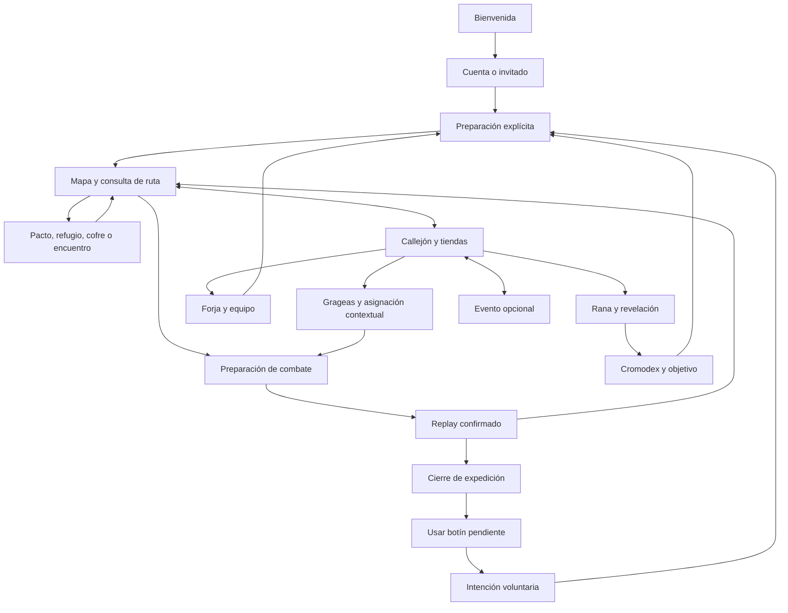

# Recorridos, decisiones y continuidad

Fuente: App.tsx, navigation.ts y consumidores actuales. Estado C; V solo para muestras identificadas en EVIDENCE. No son recorridos nuevos ejecutados.

Las flechas indican posibilidades de navegación, no automatización ni un orden obligatorio. Participar en un evento no sustituye la expedición; cuenta y Ajustes son overlays.

## Fichas del recorrido

| Tramo | Quiere conseguir / información imprescindible | Acción principal y alternativa | Consecuencia y cierre observable | Qué invita a continuar / mejora |
| --- | --- | --- | --- | --- |
| Entrar | Conservar o probar partida; identidad actual y límite de invitado | Continuar/entrar/crear según estado; invitado visible | Carga autoritativa de un propietario, sin kit repetido | Mundo listo y primera decisión; conservar jerarquía guest y campos simples |
| Recuperar | Saber si se guardó una operación y con quién | Recuperar receipt; reautenticar mismo dueño si procede | Estado y recursos reconciliados, no reenviar bajo otro dueño | Retomar el contexto; U03 sin cuenta nueva silenciosa |
| Preparar primera run | Entender puestos, copia propia, temporales y coste | Seleccionar formación y confirmar; consultar/cancelar | Run y snapshot fijados; mapa disponible | Primer Pacto/amenaza, guía ignorable; conservar A89/A90 |
| Consultar rama | Ver adyacencia, tipo, riesgo público y coste | Consultar nodo; resolver solo alcanzable | Consulta no avanza ni gasta | Elegir plan; U06 mejora caminos, lista equivalente permanece |
| Pacto | Comparar dos candidatos y cambio real | Seleccionar/confirmar; pasar o sustituir explícitamente si aplica | Una incorporación temporal o paso, oferta fija | Equipo diferente visible; no prometer candidato futuro |
| Refugio | Elegir recuperación pertinente por condición | PV/PM según oferta; pasar cuando permita contrato | Delta real antes/después, retorno al mapa | Llegar mejor al próximo rival; no inventar curación infinita |
| Cofre | Reconocer recompensa confirmada | Resolver/recoger según nodo; consulta | Operación guardada y resultado | Continuar; nada de sorteo nuevo al recargar |
| Encuentro | Comparar coste y efecto determinista por instancia | Elegir destinatario/opción y confirmar; rechazar | PV/PM/inventario de unidad correcta | Decisión condicionada por ruta; ordinal/procedencia ya implementados |
| Preparar rival | Leer composición, condición propia y posible preparación | Equipo/objetos a demanda; confirmar gasto una vez | Resultado y log guardados antes del replay | Ver cómo actúa el plan; U07/U08 sin nuevas reglas |
| Ver combate | Actor, objetivo, PV y hechos aplicados | Replay automático; pausa/consulta/2x/omitir | Desenlace solo al terminar/omitir; registro disponible | Seguir mapa o cierre; no restaurar Auto y guardado permanentes |
| Cerrar run | Resultado, premios y fuente viable siguiente | Usar botín contextual; nueva run secundaria explícita | Llave/rana/equipo consumidos o inspeccionados según acción | U02: actualizar orientación al agotar llave única |
| Comprar/abrir rana | Distinguir unidad poseída de compra; coste y probabilidad | Abrir poseída o compra+apertura confirmada; libro/cancelar | Copia/receipt antes de animar; nuevo/repetido/encantado | Colección/objetivo; U09 sin aumentar premio por espectáculo |
| Preparar gragea | Incertidumbre de sabor, stock, portador y borrador | Asignar/quitar; conservar sin consumir | Consumo y sabor solo al combate confirmado | Ver activación real; U10 limita objetos repetidos sin perder identidad |
| Coleccionar | Identidades propias, archivo, fuentes y objetivo | Consultar/elegir objetivo; filtrar/volver | Ver no descubre; temporal no es propiedad | U01/U09/U11: colección para un plan, no lista de estadísticas |
| Forjar/equipar | Comparar receta con instancia concreta, coste/renuncia | Forjar o cancelar; equipar es otra acción explícita | Nueva instancia y receipt; comparación no equipa | Probar especialización sin prometer victoria; conservar A90 |
| Bóveda | Saber si tiene llave y qué puede hacer | Abrir si tiene; consultar o destino viable si no | Llave una vez, botín confirmado | U02: ninguna repetición prometida como fuente inexistente |
| Temporada | Disponibilidad servidor, tres objetivos, recuerdo | Participar/decidir; cancelar/volver | Progreso edición y concesión propia, separados de colección base | Historia opcional, sin urgencia artificial; U04 error legible |

## Retornos y recuperación que deben conservarse

- Cerrar libro, inspector o preview vuelve al objeto de origen y conserva selección provisional cuando el contrato lo permite. Escape no cancela un commit ya enviado.
- Antes de commit, cancelación conserva recursos. Tras commit con respuesta perdida, receipt/key/propietario permiten recuperar; no animar éxito sin evidencia.
- Recargar no cambia oferta, premio, edición ni resultado. Cambiar idioma/pack no cambia reglas o stock.
- Cambiar cuenta no reenvía pending de otro dueño. El borrador de grageas se invalida por run/revisión incompatible de forma explícita.
- Históricos sirven para consultar sin nueva celebración o concesión. Región futura explica indisponibilidad; no simula una segunda campaña.

## Puntos de decisión y carga cognitiva

Cinco puestos son cinco integrantes, no cinco CTAs de igual función. Dos candidatos de Pacto y dos elecciones temáticas sí son alternativas comparables. Los filtros opcionales, inspectores y controles de cuenta no deben sumarse como decisiones obligatorias del combate. La medida útil es identificar una acción y anticipar su consecuencia en contexto, no reducir el número de etiquetas en el código.
