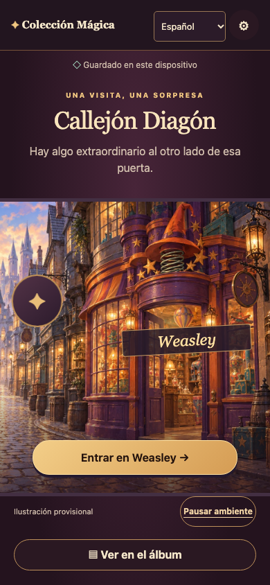
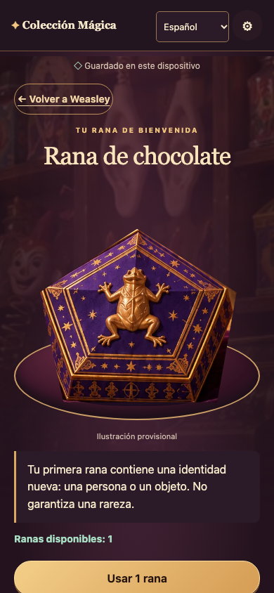

# I1 · Navegación sin menú inferior (A27)

10 de octubre de 2026. Petición: «El menú de abajo yo lo omitiría».

## Cambio implementado

Eliminada la barra inferior fija y la medición/reserva de su altura. Álbum accesible desde Callejón, Weasley y resultado, incluso sin ranas. Su botón Volver recupera la vista, posición y foco del acceso de origen; permite además salir directamente al callejón. Ajustes mantienen su acceso superior. Sin cambios de dominio, almacenamiento, catálogo, probabilidades, dependencias o alcance; PRD v0.19 y Word intactos.

Durante la revisión a 320 px con texto al 200 %, las dos columnas del álbum cortaban demasiados nombres. La cuadrícula ahora reduce columnas según el espacio y tamaño del texto. No recorta contenido para encajarlo.

## Evidencia ejecutada

Entorno local macOS; Node 24, Vite 8.3.4, Vitest 5.0.3 y motores Playwright instalados mediante lockfile. Emulación, sin dispositivo físico.

| Comprobación                                              | Resultado                                                                                                                                                                      |
| --------------------------------------------------------- | ------------------------------------------------------------------------------------------------------------------------------------------------------------------------------ |
| `npm run typecheck`                                       | Correcto                                                                                                                                                                       |
| `npm test`                                                | 23 pruebas correctas                                                                                                                                                           |
| `npm run validate:content`                                | 10 pruebas de contenido correctas                                                                                                                                              |
| `npm run build`                                           | Correcto; JS 277,16 kB / gzip 86,04 kB; CSS 23,48 kB / gzip 6,51 kB. Son tamaños de build, no transferencia medida nueva.                                                      |
| `npm run test:e2e -- --project=chromium --project=webkit` | 86 pruebas correctas (43 por motor). [Log final](browser-checks.txt).                                                                                                          |
| Regresión A27 es/en                                       | Ausencia de barra, acceso por teclado desde callejón/tienda, retorno de foco desde álbum al origen, acceso tras resultado y stock agotado, salida al callejón.                 |
| Recorridos existentes                                     | Recuperación, concurrencia, fallos, idioma, inventario, importación y reset siguen pasando. Matriz general en [I1](../i1-evidence/REPORT.md); alcance de esta revisión en A27. |

La prueba nueva falló antes de implementar al encontrar la barra. La primera ejecución completa posterior tuvo 82 pruebas correctas y cuatro fallos de sincronización: tres relecturas podían recuperar directamente el resultado antes de persistir su marca de visto; una acción por teclado competía con el foco de entrada de la tienda. Se ajustaron las pruebas a ambas rutas válidas de recuperación y a esperar el foco antes de enviar Enter. Ejecución completa repetida después de corregir y después del ajuste de cuadrícula. No se sustituyó evidencia de entrega por una animación.

## Revisión visual

Capturas reales regeneradas desde la aplicación, sin modificar las anteriores: [directorio](screenshots/). Revisión de callejón, tienda, detalle, resultado y álbum es/en a 390 px; resultado a 320 px; movimiento reducido, arte ausente y texto al 200 % a 320 px. Controles en flujo normal, sin barra que los tape; no desbordamiento horizontal en las pruebas. Verificación adicional en el navegador integrado: Callejón → Weasley → álbum → Weasley, con foco devuelto al acceso al álbum.

Pendientes conservados: lector audible, móvil físico, Firefox, observación A17 y arte final/permisos T01. No se ha repetido medición de transferencia ni medido fluidez en móvil real para este cambio. Assets provisionales existentes, sin producir arte nuevo ni llamar servicios externos.

## Git y CI

Cambio destinado a `main` mediante commit y push normal; SHA y ejecución exacta de Actions se entregan después de comprobar el run. CI existente sin modificaciones ni despliegue.
